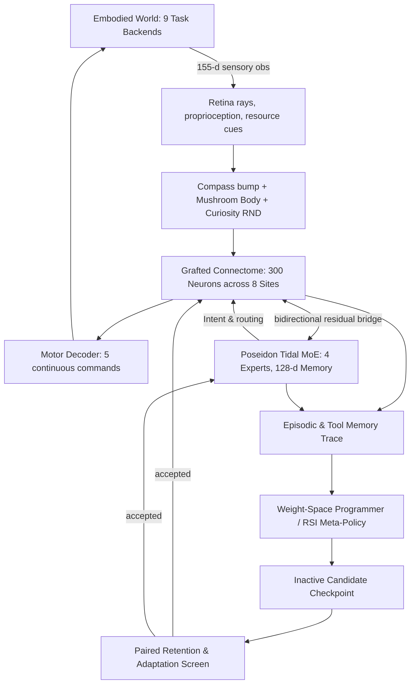

# SYNAPSE: Developmental Connectome Intelligence

**SYNAPSE** is an integrated cognitive and neuromorphic research system combining:
1. **GraftBrain** (`kai9987kai/Graft-brain`) — multi-source recurrent rate connectomes, signed Dale-law synaptic dynamics, adaptive graft plasticity, ellipsoid body heading compass, and sparse Kenyon cell associative memory.
2. **Supermix-Poseidon** (`kai9987kai/Supermix-Poseidon`) — trained Tidal DAgger MoE expert controller (327,230 parameters), recurrent memory state, and verified symbolic problem solving.
3. **Supermix-Expanse-v2** (`kai9987kai/Supermix-Expanse-v2`) — function-preserving dormant expert slots, native latent consolidation blocks, input-dependent graph gates, and evoked zero-subtracted connectome readouts.
4. **Weight-Space Programming** — transaction-safe, bounded numeric weight modifications with parent fingerprinting and exact rollback.
5. **Recursive Self-Improvement (RSI)** — inherited meta-improvement policies ($\phi$) whose accepted successors directly control subsequent candidate proposals, benchmarked on fresh-learner held-out tasks under identical budgets.

---

## Architecture Overview

SYNAPSE operates three coupled timescales:



### 1. Fast Sensorimotor Loop (Every Step)
- Connectome graph: 300 nodes distributed across three biological profiles (`flywire` central brain, `manc` ventral nerve cord, and `optic-lobe` visual system) with 552 graft edges across 8 homolog/interface sites.
- Rate dynamics: $\tau \dot{r} = -r + \sigma(W_{base} r + W_{graft} r + I)$.
- Ellipsoid body ring attractor maintaining a 16-wedge heading direction bump on $S^1$.
- Mushroom body sparse Kenyon cell expansion (top-$k$ WTA) modulating dopaminergic valence.
- Output: 5 continuous motor commands (`drive`, `turn`, `reach`, `height`, `grip`) strictly gated by connectome activity.

### 2. Slower Cognition Loop (Every 8 Steps)
- Bidirectional neural bridge: connectome context modulates Tidal resource representations, while Tidal memory and intent modulate connectome input currents.
- Trained Tidal core checkpoint (`tidal_core.pt`, SHA-256 `a053104a...`) evaluates resource states and routes across 4 MoE experts.
- Shared episodic/tool memory records queries, reasoning traces, and environment feedback.

### 3. Weight-Space Programming & RSI Loop
- Named edit surfaces: graft weights, router parameters, associative readout weights, and neural bridges. Pretrained Tidal weights remain frozen.
- Transaction safety: parent state verification, strict parameter budget bounds, finite checks, and atomic rollback.
- Inherited RSI: each generation's accepted policy program controls candidate generation for subsequent generations. Evaluated strictly on identical fresh learners with sealed query splits.

---

## Foundation Repairs & Upstream Enhancements

1. **Associative Memory Bootstrap Repair**: Corrected a defect where zero-initialized readout weights prevented eligibility traces from accumulating. SYNAPSE's `AcquiringMushroomBody` uses presynaptic eligibility to enable cue acquisition from neutral states and rapid reversal upon negative reinforcement.
2. **Actor-Critic Calibration**: Validated one-pass GAE actor-critic updates with observation-conditioned plasticity gates.
3. **Evoked & Persistent Readout**: Integrated Expanse's evoked readout mechanism (subtracting zero-input response to isolate active input response) alongside standard absolute readout.
4. **Exact Provenance & Isolation**: All 908 vendor files from GraftBrain, Poseidon, and Expanse are pinned and hash-verified against `source_manifest.json`.

---

## Upstream Capability Explorer

SYNAPSE exposes 21+ typed, audited service capabilities across 19 architecture families:

| Capability ID | Family | Name | Scope / Intended Role |
|---|---|---|---|
| `reasoning.solve` | reasoning | Problem Forge Solver | Exact verified arithmetic & AST problem solving |
| `reasoning.cartan` | reasoning | Cartan Exterior Solver | Exterior differential systems & involutivity |
| `reasoning.noether` | reasoning | Noether Symmetry Analyzer | Variational symmetries & conservation laws |
| `reasoning.causal` | reasoning | Causal Do-Calculus Solver | Pearl do-calculus intervention estimation |
| `memory.retrieve` | memory | Episodic Memory Retrieval | Query tool & episodic memory store |
| `memory.store` | memory | Episodic Memory Storage | Explicit key/value record persistence |
| `memory.mnemosyne` | memory | Mnemosyne Working Memory | Multi-timescale decaying trace buffer |
| `memory.hologram` | memory | Holographic Vector Memory | HRR circular convolution binding |
| `core.scene` | core | Poseidon Tidal Core | Tidal DAgger expert controller inference |
| `graph.substrate` | graph | Connectome Substrate | Recurrent connectome rate graph simulation |
| `graph.successor` | graph | Successor Solver | Bounded successor representation matrix |
| `embodiment.compass` | embodiment | Central Complex Compass | 16-wedge ring attractor heading bump |
| `embodiment.mushroom_body`| embodiment | Mushroom Body Learner | Sparse Kenyon cell valence plasticity |
| `embodiment.curiosity` | embodiment | RND Curiosity Bonus | Prediction error novelty bonus |
| `planning.oracle` | planning | Oracle Trajectory Planner | Forward trajectory rollout predictor |
| `nexus.phase_world` | nexus | NEXUS PhaseWorld POMDP | Discrete phase transition dynamics |
| `reliability.crosswire` | reliability | Crosswire Hypothesis Pruner| Version-space hypothesis pruning |
| `tools.archimedes` | tools | Archimedes Geometric Engine | Exact geometry & constraint evaluation |
| `expanse.male_cns` | expanse | Male CNS Core | Janelia male CNS 11,751 cell-type graph |
| `language.smollm2` | language | SmolLM2 Interface | Optional local instruct tokenization |
| `rsi.meta_evaluate` | rsi | RSI Meta-Evaluation Screen | Fresh-learner meta-policy benchmark |

---

## Quick Start

### Installation
SYNAPSE is built with Python 3.10+ (tested on Python 3.12) and PyTorch CPU:
```bash
python -m pip install -e .
```

### Launch Interactive Local Workbench
Start the local HTTP workbench server:
```powershell
.\launch.ps1 -Port 8765
# Or on Windows cmd:
Run-Synapse.cmd
```
Then navigate in your browser to:
```
http://127.0.0.1:8765
```

The workbench provides 5 interactive panes:
- **01 Live Workbench**: Real-time canvas rendering of connectome activation graphs, 3D world projections, ray-cast visual sensors, and routing telemetry.
- **02 Capabilities**: Interactive explorer to inspect schemas and invoke all 21+ audited capabilities.
- **03 Weight Programs**: Author, preview, apply, and rollback bounded numeric patch packets.
- **04 Experiments & RSI**: Configure and execute bounded background RSI studies with job monitoring and lineage graphs.
- **05 State Archive**: Save, load, and inspect exact agent and world session checkpoints.

### CLI Usage
```bash
# Inspect agent and connectome status
python -m synapse.cli status

# Run 100 simulation steps in the forage environment
python -m synapse.cli run --steps 100 --save my_checkpoint

# Train with active plasticity for 500 steps
python -m synapse.cli train --steps 500 --save trained_agent

# Invoke a specific capability via CLI
python -m synapse.cli capabilities --id reasoning.solve --payload "{\"expression\":\"40 + 2\"}"

# Start a bounded RSI study
python -m synapse.cli study --name pilot-study
```

---

## Running the Verification Suite

Run the full pytest suite:
```bash
python -m pytest
```

All 31 comprehensive test suites verify:
- Bidirectional neural coupling & bridge preparation
- Acquiring mushroom body learning and reversal
- Exact checkpoint state round-trip & inference freeze
- Bounded patch application, stale parent rejection, and atomic rollback
- Fresh-learner RSI policy inheritance & receipt verification
- Multi-backend world simulation across all 9 native tasks
- Loopback security, CSP headers, and input boundary validation
- Upstream capability catalog coverage & memory consumer wiring

---

## Limitations & Evidence Boundaries

- **Synthetic Connectome Profiles**: Unless configured with an external Janelia male-CNS dataset, graph nodes represent synthetic proxy profiles shaped after FlyWire, MANC, and Optic Lobe topologies. They are not living biological brains.
- **CPU-First Scale**: SYNAPSE is optimized for CPU execution. Bounded graph sizes (16–500 nodes per source) ensure reproducible sub-second simulation cycles.
- **RSI Evidence**: Inherited meta-policies evolve algorithmic search parameters (learning rates, update counts, replay multiplicity); this represents bounded parameter search rather than open-ended artificial general intelligence.
