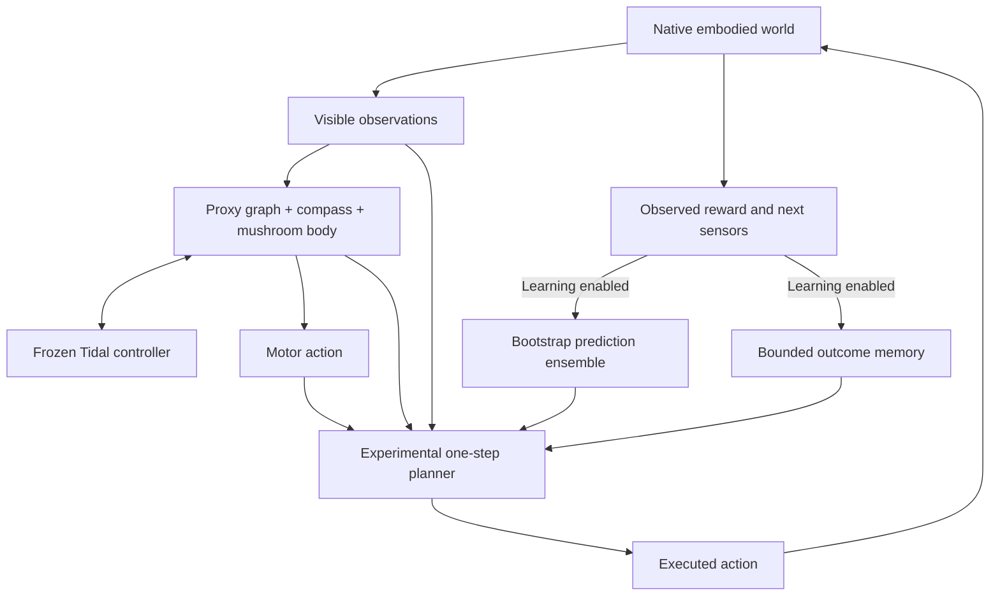

---
language:
- en
tags:
- connectome
- neuromorphic
- weight-space-programming
- continual-learning
- pytorch
license: apache-2.0
---

# SYNAPSE

A CPU research workbench for coupled recurrent graphs, a frozen Poseidon Tidal controller, persistent weight edits, and experience-conditioned action experiments. Pinned GraftBrain, Poseidon, and Expanse sources supply the building blocks. The live actor uses small proxy connectomes; anatomical metadata and standalone biological analyses are separate from those graphs.

The latest upgrade connects learned prediction and surprise memory to executed actions, repairs checkpoint training and camera wiring, and replaces the old hard-coded evidence report with measured experiments. Performance benefits remain experimental. Read the [research review](docs/research/2026-11-06-experience-learning-review.md) and [results and limitations](docs/results/2026-11-06-experience-adaptation.md).

## What runs together



| Component | Behavior and evidence boundary |
|---|---|
| Graph/Tidal actor | Bidirectional coupling, associative learning, compass, neuromodulation and glial/predictive heuristics. Bridge and motor weights begin untrained. |
| Experience model | Three bootstrap RLS members learn sensor deltas and actual reward. Live neural summaries condition prediction; their future dynamics are excluded. Leverage and disagreement are uncalibrated heuristics. |
| Surprise memory | Up to 128 actual state/action/reward outcomes, selective error/coverage writes, and pure distance/recency reads. |
| Planner | Original action plus ten local alternatives, changing at most one coordinate by 0.35. Requires support, lower prequential error than a reward-average baseline, and a conservative predicted advantage. Off by default; immediate reward only. |
| Checkpoints | Preserve ensemble, covariance, RNG, memory, pending outcome, visual weights, optimizer bindings, world state and neuromodulatory reward baseline. Ordinary supported learning resumes exactly in tests. |
| Camera | Causally affects actions, accepts supervised preparation gradients and persists parameters. This establishes wiring, not recognition performance. |
| Weight edits | Bounded packets, parent fingerprints, candidate checks and rollback. Optional measured guard screening binds approval to the assessed delta and target; no task gain is invented. |
| Capabilities | Typed access to imported reasoning tools and exploratory modules. Available does not mean useful for the live task. |

## Run locally

Python 3.10+ with CPU PyTorch, NumPy and SciPy:

```powershell
python -m pip install -e .
python -m pytest -q
.\launch.ps1 -Port 8765
```

Open [the local workbench](http://127.0.0.1:8765). Run-Synapse.cmd is also available.

The workbench provides zero-warping live 3D isometric & top-down radar world views, an interactive 3D anatomical connectome observatory with real-time neuron inspection and mouse orbit, direct teleoperation controls (WASD/arrows/space), capabilities explorer, weight programs, bounded RSI jobs, and advanced assay panels (Causal Circuit Atlas, Weight-Space Hypernetwork synthesis, Flagship benchmarks, and State Archive). In **Experience learning & surprise memory**, use **Train +32** to collect real outcomes, select the action policy, and click **Set policy**. Switching preserves experience. Actor-only mode continues collecting memory when learning is enabled; model-only mode disables memory writes. With learning off, model and memory stay frozen while recurrent inference state advances.

Prediction and baseline RMSE, gate status, memory occupancy and planner decisions are inspectable. The planner may abstain for an entire run. Finite predictions or accepted edits do not establish improved behavior.

```powershell
python -m synapse.cli --nodes 16 status
python -m synapse.cli --nodes 16 train --steps 100 --save trained
python -m synapse.cli --nodes 16 autoprogram --diagnostic-episodes 2 --eval-episodes 2
```

Programmatic planning uses SynapseConfig(experience_planning=True) or agent.act(obs, planner_mode='memory'). LabRuntime.step(..., learn=True) attributes outcomes to executed actions. External collectors can call agent.observe_transition(next_obs, reward, done, action=applied) once after an action.

## Measured experiments

The evidence command now runs actual native worlds. Actor-only, model-only, model-plus-memory and shuffled-reward controls share support; learned state freezes on separately seeded query worlds.

```powershell
python -m synapse.cli --output outputs evidence --name my-pilot --seeds 7 11 19 --tasks forage push --support-steps 64 --query-steps 64
python -m synapse.cli adaptation-verify outputs/adaptation-studies/my-pilot
python -m synapse.cli evidence --receipt outputs/adaptation-studies/my-pilot
python -m synapse.continual_probe --output outputs/continual-probe.json
```

Studies save raw support/query records, checkpoints, signed per-unit return differences, descriptive paired intervals, costs, source/dependency fingerprints and freeze checks. Verification replays arithmetic and hashes; it does not rerun the environment or independently authenticate recorded claims. Source changes produce explicit warnings.

The controlled stream separately tests hidden reward reversal/recurrence and old-regime interference. These are small development pilots. The original ungated native pilot regressed on average, and memory did not change its chosen actions. That result motivated the prediction gate. The controlled probe also exposed worse prediction error during reversal and old-regime interference; keep these negatives.

Existing study / verify commands remain a separate numeric cue-readout RSI pilot. Its stored earlier final recursive-minus-fixed advantage was zero; direct cue access and reused task features limit interpretation.

## Experimental boundaries

The [design](docs/superpowers/specs/2026-11-06-experience-grounded-adaptation-design.md) and [plan](docs/superpowers/plans/2026-11-06-experience-grounded-adaptation.md) record this upgrade. The research review links primary work on continual plasticity, TTT, Titans, PETS, RefPlan and executed-action attribution, and states algorithm differences. These CPU adaptations are not reproductions or a broad intelligence claim.

Legacy flagship transfer and recursive-learning modules contain independent-module and analytic hyperparameter surrogates. Their success flags do not establish embodied recipient transfer, statistical superiority or recursive improvement. The old standalone neural world model's confidence head is uncalibrated. Metamorphic checks are sampled relations, not formal proofs. Arbitrary legacy topology mutations can leave graph metadata/buffers inconsistent and are outside ordinary checkpoint guarantees. Supervised preparation still approximates parts of the live recurrent policy.

No paid compute, remote publication or upstream source modification is required. Source provenance is recorded in synapse/source_manifest.json.
