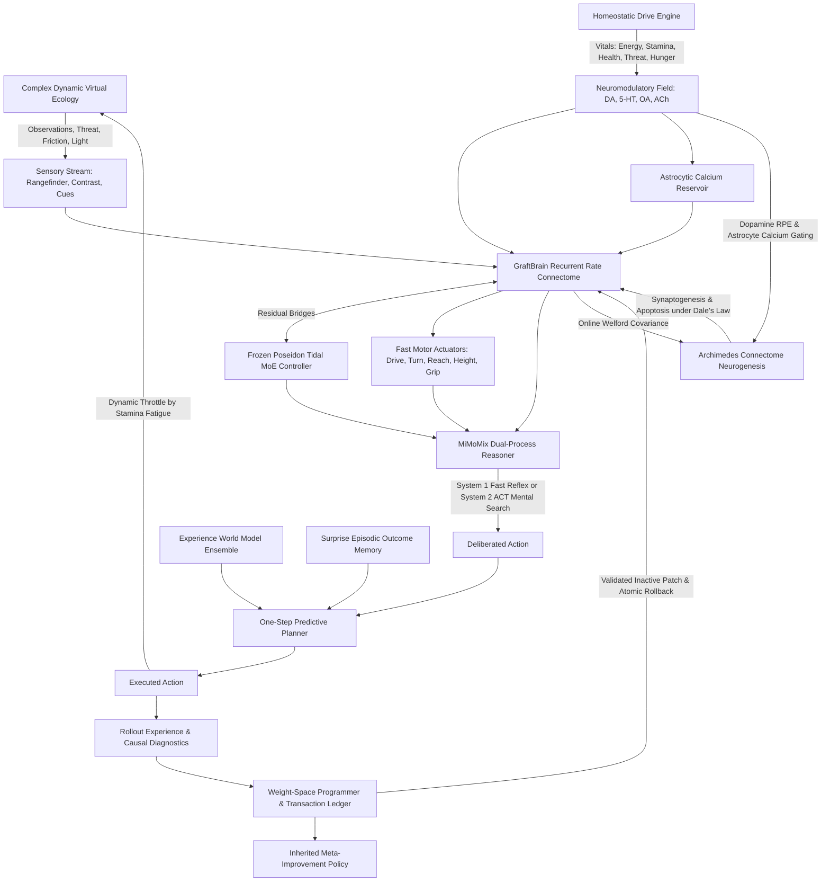

---
language:
- en
tags:
- connectome
- neuromorphic
- weight-space-programming
- continual-learning
- pytorch
- neurogenesis
- homeostasis
- dual-process-reasoning
license: apache-2.0
---

# SYNAPSE: Developmental Connectome Intelligence & Weight-Space Lab

A unified, CPU-first embodied cognitive research platform combining signed recurrent neural graphs, a frozen Poseidon Tidal MoE DAgger controller, continuous online connectome neurogenesis, interoceptive homeostatic drive regulation, MiMoMix dual-process cognitive deliberation, experience-grounded prediction, and direct weight-space programming with inherited recursive self-improvement (RSI).

Live telemetry, real-time 3D anatomical connectome visualization, and zero-warping virtual world observatory are served via a local web interface and audited CLI tools.

## Architecture



## System Components & Evidence Boundaries

| Subsystem | Architectural Role | Governing Dynamics & Evidence Boundary |
|---|---|---|
| **Recurrent Connectome Substrate** | Fast sensorimotor rate dynamics | Signed base connectivity across FlyWire, MANC, and Optic Lobe profiles, 8 inter-module graft sites, Dale's law compliance, and ellipsoid body compass bump. |
| **Tidal MoE Controller** | Pretrained goal & intent donor | Pinned Poseidon Tidal core (`tidal_core.pt`, SHA-256 `a053104a...`), 4 experts, 128 hidden width, 2 recurrent steps, 6 categorical intent classes (`rest`, `forage`, `drink`, `shelter`, `explore`, `flee`). Kept frozen during ordinary execution. |
| **Archimedes Neurogenesis Engine** | Dynamic structural plasticity | Continuous online Welford covariance tracking; apoptosis of inactive synapses ($|w| < \theta_{\text{prune}}$); synaptogenesis of high-covariance neural pairs gated by Dopamine RPE and Astrocytic $[\text{Ca}^{2+}]$; strict Dale's law sign preservation. |
| **Supermix Homeostatic Drives** | Interoceptive physiological regulation | Continuous tracking of 6 bodily vitals (Energy, Stamina, Health, Threat, Exposure, Hunger); dynamic neuromodulator coupling ($\text{DA}, 5\text{-HT}, \text{OA}, \text{ACh}$); physical forward thrust limits under stamina fatigue. |
| **MiMoMix Cognitive Core** | Dual-process cognitive deliberation | Epistemic trigger monitoring free energy, surprisal, and hazard proximity; fast reflexive System 1 intuition vs. multi-step System 2 Adaptive Computation Time (ACT) mental rollouts with attention sink null-slots and ponder penalties. |
| **Experience World Model** | Prequential dynamics prediction | 3-member deterministic bootstrap RLS ensemble predicting sensor summary deltas and reward conditioned on live graph/Tidal representations. Disagreement and leverage provide uncalibrated heuristics. |
| **Surprise Episodic Memory** | Error-gated outcome storage | Bounded capacity (128 entries); selective error/coverage admission; pure distance and recency weighted retrieval; non-mutating reads. |
| **Complex Dynamic Ecology** | Embodied virtual simulation | Continuous 2D/3D physics environment featuring autonomous moving predator drones with threat auras, variable-friction terrain zones (ice, mud, sand), dynamic oscillating/locked gates, and diurnal ambient illumination cycles. |
| **Weight-Space Programming** | Safe transactional parameter editing | Bounded edit packets, parent hash validation, candidate evaluation, exact state rollback, and closed-loop automated diagnosis/repair. |
| **Recursive Self-Improvement (RSI)** | Meta-level learning of learning | Versioned improvement policies $\phi_g$, support/query task isolation, shared archive controls, candidate meta-validation, and fresh-learner held-out evaluations. |
| **Zero-Warping Observatory & HUD** | Real-time scientific visualization | Isotropic 3D isometric and top-down radar views with mathematical aspect ratio locking; real-time 3D anatomical connectome observatory with OrbitControls; direct WASD teleoperation; real-time Vitals HUD meters. |

## Run Locally

Requires Python 3.10+ with PyTorch CPU, NumPy, and SciPy:

```powershell
python -m pip install -e .
python -m pytest -q
.\launch.ps1 -Port 8765
```

Open the local workbench at [http://127.0.0.1:8765](http://127.0.0.1:8765) or launch via `Run-Synapse.cmd`.

### Interactive Workbench Features
- **Zero-Warping World Views**: True isotropic aspect ratio rendering for both 3D isometric projection and top-down radar world views, ensuring square cells remain square under all window resizes.
- **Complex Ecology Telemetry**: Real-time visualization of terrain friction zones (ice, mud, sand), moving predator drones with hazard danger rings, dynamic gates, day/night ambient lighting, and resource targets.
- **Direct Keyboard Teleoperation**: Control the embodied agent in real-time using WASD or Arrow Keys, with Spacebar for object grab/place.
- **3D Anatomical Connectome Observatory**: Interactive 3D point-cloud and synaptic edge visualization with OrbitControls (left-click rotate, right-click pan, scroll zoom) and click-to-inspect individual neuron activity.
- **Homeostatic Vitals & Cognition HUD**: Real-time meters for Energy, Stamina, Health, Threat, Exposure, and Hunger, paired with MiMoMix System 1 / System 2 deliberation badges and ACT ponder steps.
- **Scientific Assay Panels**: Causal Circuit Atlas, Weight-Space Hypernetwork synthesis, Flagship evolutionary benchmarks, State Archives, and Audited Capabilities Explorer.

## Command Line Interface (CLI)

SYNAPSE provides comprehensive CLI commands for headless execution, experiments, and inspection:

```powershell
# Inspection & Baseline Execution
python -m synapse.cli --nodes 16 status
python -m synapse.cli --nodes 16 run --steps 100
python -m synapse.cli --nodes 16 train --steps 100 --save trained_agent

# Supermix Beyond Capabilities
python -m synapse.cli --nodes 16 neurogenesis
python -m synapse.cli --nodes 16 homeostasis
python -m synapse.cli --nodes 16 mimomix --ponder 4
python -m synapse.cli --nodes 16 ecology --task ecosystem

# Audited Upstream Capabilities (126 audited capabilities across 47 families)
python -m synapse.cli capabilities --id structural.neurogenesis
python -m synapse.cli capabilities --id motivation.homeostasis
python -m synapse.cli capabilities --id reasoning.mimomix
python -m synapse.cli capabilities --id world.complex_ecology

# Automated Weight-Space Programming & Closed-Loop Repair
python -m synapse.cli --nodes 16 autoprogram --diagnostic-episodes 3 --eval-episodes 3 --save repaired_agent
python -m synapse.cli --nodes 16 transplant --donor-task forage --test-task delayed_match
python -m synapse.cli --nodes 16 metamorphic
python -m synapse.cli --nodes 16 spectral
python -m synapse.cli --nodes 16 hyperprogram --target motor.weight

# Measured Adaptation Experiments
python -m synapse.cli --output outputs evidence --name my-pilot --seeds 7 11 19 --tasks forage push --support-steps 64 --query-steps 64
python -m synapse.cli adaptation-verify outputs/adaptation-studies/my-pilot
python -m synapse.cli evidence --receipt outputs/adaptation-studies/my-pilot
```

## Measured Experiments & Verification

Empirical evidence studies run on actual native and complex environments with strictly separated support and query worlds:
- **Support Adaptation**: Shared exploratory support trajectories condition the learner.
- **Query Freeze**: All model and memory learning is strictly frozen during query episodes.
- **Replay & Audit Receipts**: Full cryptographic digests, parameter matrices, RNG states, and execution timings are recorded in atomic JSON receipts.

## Upstream Lineage & Research Grounding

SYNAPSE unifies innovations from:
- **GraftBrain**: Signed recurrent neural dynamics, biological neuropil topologies, mushroom body associative learning, and embodied planar physics.
- **Supermix-Poseidon**: Trained Tidal MoE DAgger controller, predictive horizons, causal intervention analyzers, and multi-expert routing.
- **Supermix-Expanse**: Function-preserving dormant experts, native consolidation, evoked graph readouts, and male-CNS connectome data.
- **Archimedes v93**: Continuous covariance-driven structural neurogenesis, synaptogenesis, and apoptosis.
- **Supermix Beyond**: Interoceptive homeostatic drive regulation, MiMoMix dual-process cognitive deliberation, and complex multi-hazard virtual ecology.

All source code is released under the Apache 2.0 license. Detailed source manifests and hashes are preserved in `synapse/source_manifest.json`.
