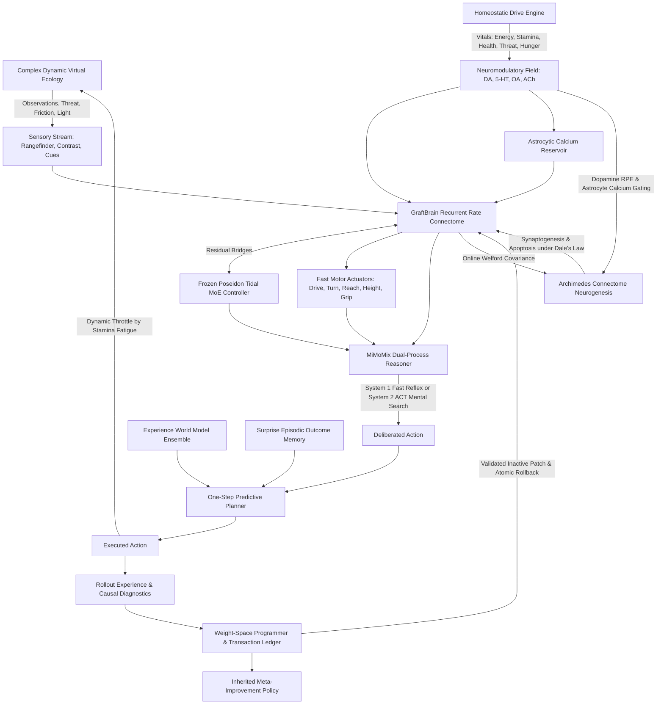

---
language:
- en
tags:
- connectome
- neuromorphic
- weight-space-programming
- continual-learning
- pytorch
- neurogenesis
- homeostasis
- dual-process-reasoning
license: apache-2.0
---

# SYNAPSE: Developmental Connectome Intelligence & Weight-Space Lab (SAIL Edition)

A unified, CPU-first embodied cognitive research platform combining signed recurrent neural graphs, a frozen Poseidon Tidal MoE DAgger controller, continuous online connectome neurogenesis, interoceptive homeostatic drive regulation, MiMoMix dual-process cognitive deliberation, experience-grounded prediction, and direct weight-space programming with inherited recursive self-improvement (RSI).

Now featuring the **Sonapse Adaptive Intelligence Laboratory (SAIL)** research track: utility-driven continual backpropagation, trainable student-teacher sleep consolidation, universal fast-weight memory (uTTT & Titans associative learning), recurrent multi-step world models with MPC planning ($H \in \{1, 3, 5, 10\}$), verifiable ReLIFT curriculum challenges, and causal connectome structural evolution.

Live telemetry, real-time 3D anatomical connectome visualization, and zero-warping virtual world observatory are served via a local web interface and audited CLI tools.

## Architecture



## System Components & Evidence Boundaries

| Subsystem | Architectural Role | Governing Dynamics & Evidence Boundary |
|---|---|---|
| **Recurrent Connectome Substrate** | Fast sensorimotor rate dynamics | Signed base connectivity across FlyWire, MANC, and Optic Lobe profiles, 8 inter-module graft sites, Dale's law compliance, and ellipsoid body compass bump. |
| **Tidal MoE Controller** | Pretrained goal & intent donor | Pinned Poseidon Tidal core (`tidal_core.pt`, SHA-256 `a053104a...`), 4 experts, 128 hidden width, 2 recurrent steps, 6 categorical intent classes (`rest`, `forage`, `drink`, `shelter`, `explore`, `flee`). Kept frozen during ordinary execution. |
| **Archimedes Neurogenesis Engine** | Dynamic structural plasticity | Continuous online Welford covariance tracking; apoptosis of inactive synapses ($|w| < \theta_{\text{prune}}$); synaptogenesis of high-covariance neural pairs gated by Dopamine RPE and Astrocytic $[\text{Ca}^{2+}]$; strict Dale's law sign preservation. |
| **Supermix Homeostatic Drives** | Interoceptive physiological regulation | Continuous tracking of 6 bodily vitals (Energy, Stamina, Health, Threat, Exposure, Hunger); dynamic neuromodulator coupling ($\text{DA}, 5\text{-HT}, \text{OA}, \text{ACh}$); physical forward thrust limits under stamina fatigue. |
| **MiMoMix Cognitive Core** | Dual-process cognitive deliberation | Epistemic trigger monitoring free energy, surprisal, and hazard proximity; fast reflexive System 1 intuition vs. multi-step System 2 Adaptive Computation Time (ACT) mental rollouts with attention sink null-slots and ponder penalties. |
| **Experience World Model** | Prequential dynamics prediction | 3-member deterministic bootstrap RLS ensemble predicting sensor summary deltas and reward conditioned on live graph/Tidal representations. Disagreement and leverage provide uncalibrated heuristics. |
| **Surprise Episodic Memory** | Error-gated outcome storage | Bounded capacity (128 entries); selective error/coverage admission; pure distance and recency weighted retrieval; non-mutating reads. |
| **Complex Dynamic Ecology** | Embodied virtual simulation | Continuous 2D/3D physics environment featuring autonomous moving predator drones with threat auras, variable-friction terrain zones (ice, mud, sand), dynamic oscillating/locked gates, and diurnal ambient illumination cycles. |
| **Weight-Space Programming** | Safe transactional parameter editing | Bounded edit packets, parent hash validation, candidate evaluation, exact state rollback, and closed-loop automated diagnosis/repair. |
| **Recursive Self-Improvement (RSI)** | Meta-level learning of learning | Versioned improvement policies $\phi_g$, support/query task isolation, shared archive controls, candidate meta-validation, and fresh-learner held-out evaluations. |
| **Zero-Warping Observatory & HUD** | Real-time scientific visualization | Isotropic 3D isometric and top-down radar views with mathematical aspect ratio locking; real-time 3D anatomical connectome observatory with OrbitControls; direct WASD teleoperation; real-time Vitals HUD meters. |
| **Continual Backpropagation** | Utility-guided plasticity & replacement | Continuous utility tracking $u_i(t) = \beta u_i(t-1) + (1-\beta)|r_i|\sum_j |W_{ji}|$; resets mature stagnant units while clearing Adam moments and preserving Dale's law. |
| **Trainable Sleep Engine** | Student-teacher consolidation | Minimizes $\mathcal{L}_{\text{sleep}} = \lambda_1\mathcal{L}_{\text{task}} + \lambda_2\mathcal{L}_{\text{distill}} + \lambda_3\mathcal{L}_{\text{replay}} + \lambda_4\mathcal{L}_{\text{reg}}$ with SHY synaptic downscaling and evaluation rollback gating. |
| **Universal Fast-Weight Memory** | Test-time associative learning | Shared associative matrix $M \in \mathbb{R}^{d_k \times d_v}$ with self-supervised inner loss $\mathcal{L}_{\text{inner}}$, surprise-gated outer-product updates, and surprise gating. |
| **Recurrent Multistep Planner** | Learned dynamics & MPC control | Recurrent GRU state transition, reward, observation, and uncertainty heads; MPC action trajectory optimization over horizons $H \in \{1, 3, 5, 10\}$ with penalty for epistemic variance. |
| **Verifiable Curriculum Engine** | Verifiable progression & ReLIFT | Procedural sequential subgoals (`CUE_DISCOVERED`, `GATE_TRIGGERED`, `BARRIER_PASSED`, `TARGET_REACHED`) with cryptographic SHA-256 process receipts. |
| **Causal Connectome Evolution** | Interventional structural changes | Paired counterfactual rollouts measuring $\Delta J(m) = \mathbb{E}[R \mid do(m)] - \mathbb{E}[R \mid do(m_0)]$ penalized by wiring, compute, and catastrophic forgetting costs. |
| **Verifier-Gated Bounded RSI** | Bounded self-improvement & failure archive | AIDE² / DGM / AlphaEvolve pattern: AST range checks, deterministic tests, support/query evaluation, LCB dominance ($LCB(\Delta) > \epsilon$), canary regression gating ($\le 1\%$), and immutable Failure Archive. |
| **World Model v2 & CEM Planner** | Recurrent dynamics ensemble & CEM | $M=3$ latent dynamics ensemble with JEPA loss, CEM trajectory optimization across horizons $H \in \{1, 3, 5, 10\}$, fallback shield to frozen Tidal, and exploitation tracking ($G_{\text{exploit}} = R_{\text{pred}} - R_{\text{real}}$). |
| **9-Arm Connectome Causal Assay** | Biological vs matched controls | Causal benchmark evaluating real Drosophila wiring against 8 matched nulls (degree-, sign-, community-rewired, random, learned, unsigned, local-only, brain-cord motif) calculating formal Cohen's $d$. |
| **Coconut Latent Deliberation** | Tokenless continuous recurrence | Continuous hidden-state thought recurrence ($h^{\text{think}}_{i+1} = F(h^{\text{think}}_i, z_t)$), dynamic ponder halting, and anytime compute-depth curves. |
| **Masked Diffusion Repair Sidecar** | Non-autoregressive repair & infill | Iterative masked diffusion repair of failing code, configuration, or action trajectory constraints with executable verifier in the loop. |
| **Machine-Verifiable DPO Engine** | Direct preference optimization | First-party machine-checked preference pairs (safety, return, unit tests) optimized via DPO without ungrounded self-judging loops. |
| **Unified Evaluation Scorecard** | Calibrated multi-dimensional scoring | Joint deployment score $S = R - \alpha C - \beta U - \gamma F$ balancing task return, compute cost, calibration (Brier / ECE), and safety failures. |


## Run Locally

Requires Python 3.10+ with PyTorch CPU, NumPy, and SciPy:

```powershell
python -m pip install -e .
python -m pytest -q
.\launch.ps1 -Port 8765
```

Open the local workbench at [http://127.0.0.1:8765](http://127.0.0.1:8765) or launch via `Run-Synapse.cmd`.

### Interactive Workbench Features
- **Zero-Warping World Views**: True isotropic aspect ratio rendering for both 3D isometric projection and top-down radar world views, ensuring square cells remain square under all window resizes.
- **Complex Ecology Telemetry**: Real-time visualization of terrain friction zones (ice, mud, sand), moving predator drones with hazard danger rings, dynamic gates, day/night ambient lighting, and resource targets.
- **Direct Keyboard Teleoperation**: Control the embodied agent in real-time using WASD or Arrow Keys, with Spacebar for object grab/place.
- **3D Anatomical Connectome Observatory**: Interactive 3D point-cloud and synaptic edge visualization with OrbitControls (left-click rotate, right-click pan, scroll zoom) and click-to-inspect individual neuron activity.
- **Homeostatic Vitals & Cognition HUD**: Real-time meters for Energy, Stamina, Health, Threat, Exposure, and Hunger, paired with MiMoMix System 1 / System 2 deliberation badges and ACT ponder steps.
- **Scientific Assay Panels**: Causal Circuit Atlas, Weight-Space Hypernetwork synthesis, Flagship evolutionary benchmarks, State Archives, and Audited Capabilities Explorer.

## Command Line Interface (CLI)

SYNAPSE provides comprehensive CLI commands for headless execution, experiments, and inspection:

```powershell
# Inspection & Baseline Execution
python -m synapse.cli --nodes 16 status
python -m synapse.cli --nodes 16 run --steps 100
python -m synapse.cli --nodes 16 train --steps 100 --save trained_agent

# Supermix Beyond Capabilities
python -m synapse.cli --nodes 16 neurogenesis
python -m synapse.cli --nodes 16 homeostasis
python -m synapse.cli --nodes 16 mimomix --ponder 4
python -m synapse.cli --nodes 16 ecology --task ecosystem

# Audited Upstream Capabilities (139 audited capabilities across 47 families)
python -m synapse.cli capabilities --id structural.neurogenesis
python -m synapse.cli capabilities --id motivation.homeostasis
python -m synapse.cli capabilities --id reasoning.mimomix
python -m synapse.cli capabilities --id world.complex_ecology
python -m synapse.cli capabilities --id learning.continual_backprop
python -m synapse.cli capabilities --id memory.fast_weights

# SAIL 6-Upgrade Research & Development Suite
python -m synapse.cli continual-backprop --steps 50
python -m synapse.cli sleep-train --sleep-steps 10
python -m synapse.cli fast-memory --steps 30
python -m synapse.cli multistep-plan --horizons 1 3 5 10 --trials 3
python -m synapse.cli curriculum-verify --stages 3 --trials-per-stage 3
python -m synapse.cli causal-growth --candidates 3
python -m synapse.cli flagship-milestone --steps-per-task 20

# Deep Research Architecture & Control Experiments
python -m synapse.cli rsi-verify --patch-type config
python -m synapse.cli world-model-cem --cem-horizon 5
python -m synapse.cli connectome-assay --assay-trials 3
python -m synapse.cli coconut-think --think-depth 4
python -m synapse.cli diffusion-repair --repair-iters 3
python -m synapse.cli dpo-align --pairs 5
python -m synapse.cli unified-eval --eval-task forage

# Automated Weight-Space Programming & Closed-Loop Repair
python -m synapse.cli --nodes 16 autoprogram --diagnostic-episodes 3 --eval-episodes 3 --save repaired_agent
python -m synapse.cli --nodes 16 transplant --donor-task forage --test-task delayed_match
python -m synapse.cli --nodes 16 metamorphic
python -m synapse.cli --nodes 16 spectral
python -m synapse.cli --nodes 16 hyperprogram --target motor.weight

# Measured Adaptation Experiments
python -m synapse.cli --output outputs evidence --name my-pilot --seeds 7 11 19 --tasks forage push --support-steps 64 --query-steps 64
python -m synapse.cli adaptation-verify outputs/adaptation-studies/my-pilot
python -m synapse.cli evidence --receipt outputs/adaptation-studies/my-pilot
```

## Measured Experiments & Verification

Empirical evidence studies run on actual native and complex environments with strictly separated support and query worlds:
- **Support Adaptation**: Shared exploratory support trajectories condition the learner.
- **Query Freeze**: All model and memory learning is strictly frozen during query episodes.
- **Replay & Audit Receipts**: Full cryptographic digests, parameter matrices, RNG states, and execution timings are recorded in atomic JSON receipts.

## Upstream Lineage & Research Grounding

SYNAPSE unifies innovations from:
- **GraftBrain**: Signed recurrent neural dynamics, biological neuropil topologies, mushroom body associative learning, and embodied planar physics.
- **Supermix-Poseidon**: Trained Tidal MoE DAgger controller, predictive horizons, causal intervention analyzers, and multi-expert routing.
- **Supermix-Expanse**: Function-preserving dormant experts, native consolidation, evoked graph readouts, and male-CNS connectome data.
- **Archimedes v93**: Continuous covariance-driven structural neurogenesis, synaptogenesis, and apoptosis.
- **Supermix Beyond**: Interoceptive homeostatic drive regulation, MiMoMix dual-process cognitive deliberation, and complex multi-hazard virtual ecology.

All source code is released under the Apache 2.0 license. Detailed source manifests and hashes are preserved in `synapse/source_manifest.json`.
