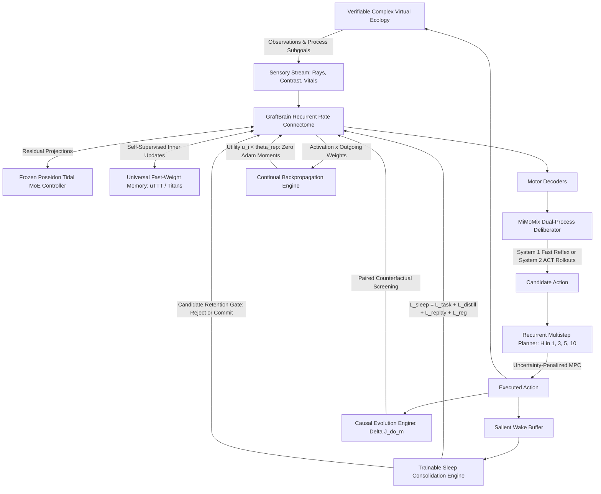

# Sonapse Adaptive Intelligence Laboratory (SAIL): Advanced Research & Development Roadmap

**Repository:** `kai9987kai/Sonapse-LAB`  
**Date:** 6 November 2026  
**Revision:** 1.0 (SAIL Implementation Baseline)  
**Status:** In Progress & Production Research Track

---

## 1. Executive Objective

Develop **Sonapse-LAB** into a self-adapting, biologically grounded artificial intelligence research platform. Rather than serving as another general-purpose language model wrapper, Sonapse specialises in experimentally investigating how intelligent behavior emerges from networks that dynamically reshape both their weights and their topological graphs across continuous experience.

The core distinguishing paradigm of the **Sonapse Adaptive Intelligence Laboratory (SAIL)** is the closed-loop interaction of five pillars:

$$\text{Intelligence} = \text{Neural Plasticity} + \text{Developmental Growth} + \text{World-Model Learning} + \text{Metacognition} + \text{Verified Self-Improvement}$$

---

## 2. Baseline Problem: Addressing the 6 November Negative Planning Pilot

The repository's 6 November 2026 empirical study (`docs/results/2026-11-06-experience-adaptation.md`) documented an honest, crucial negative result:
- In fixed-step evaluations across 10 actor/world units, heuristic 1-step bootstrap RLS models with distance memory performed slightly worse or statistically indistinguishable from the baseline actor.
- *Root Cause:* Uncalibrated 1-step imagination, unshared isolated memories, and heuristic sleep consolidation without gradient recording.

**SAIL's Core Imperative:** Make the agent learn directly from verified physical and epistemic transitions, providing demonstrable empirical gains under matched compute budgets before scaling architectural complexity.

---

## 3. SAIL Next-Generation Architecture

---

## 4. The Six Core Technical Upgrades

### Upgrade A: Continual Backpropagation & Utility-Guided Replacement (`synapse/continual_backprop.py`)
- **Scientific Foundation:** Dohare et al. (*Nature*, 2024), "Continual backpropagation".
- **Utility Metric:**
  $$u_i(t) = \beta u_i(t-1) + (1-\beta) \tilde{u}_i(t), \quad \tilde{u}_i(t) = |r_i(t)| \sum_j |W_{ji}(t)|$$
- **Replacement Policy:** Mature units ($t \ge t_{\text{mature}}$) with $u_i < \theta_{\text{replace}}$ are re-initialized, strictly preserving Dale's law signs for inhibitory vs. excitatory phenotypes.
- **Optimizer Moment Reset:** Completely zeroes first ($m$) and second ($v$) Adam moments for replaced weights in `optimizer.state[param]`, eliminating stale gradient inertia.

### Upgrade B: Trainable Sleep Consolidation (`synapse/sleep.py`)
- **Scientific Foundation:** Google Research (October 2026), "Sleep: Continual Learning Framework with Trainable Consolidation".
- **Objective Formulation:**
  $$\mathcal{L}_{\text{sleep}} = \lambda_{\text{task}} \mathcal{L}_{\text{task}} + \lambda_{\text{distill}} \mathcal{L}_{\text{distill}} + \lambda_{\text{replay}} \mathcal{L}_{\text{replay}} + \lambda_{\text{reg}} \mathcal{L}_{\text{regularise}}$$
  - $\mathcal{L}_{\text{task}}$: Loss on salient recent wake-phase episodes.
  - $\mathcal{L}_{\text{distill}}$: Knowledge distillation matching pre-sleep teacher predictions on anchor observations.
  - $\mathcal{L}_{\text{replay}}$: Anti-forgetting replay on multi-task long-term episodic buffer.
  - $\mathcal{L}_{\text{reg}}$: Parameter regularization $\sum_p \|\theta_p - \theta_p^0\|^2$.
- **Candidate Gate:** Pre-sleep vs. post-sleep validation. If retention regresses, the candidate weights are rolled back atomically.

### Upgrade C: Universal Fast-Weight Memory (`synapse/fast_weight_memory.py`)
- **Scientific Foundation:** Universal Test-Time Training (uTTT) & Titans (Fast-Weight Memory).
- **Online Gradient Descent:**
  $$M_{t+1} = (1 - \lambda_{\text{decay}}) M_t - \eta_t \nabla_M \mathcal{L}_{\text{inner}}(M_t, x_t)$$
  $$\mathcal{L}_{\text{inner}}(M, x) = \frac{1}{2} \|M \phi(x) - \psi(x)\|^2$$
- **Surprise Gating:** Modulates inner step size by real-time prediction error: $\eta_t = \eta_0 (1 + \sigma(\text{surprisal}_t))$.

### Upgrade D: Recurrent Multistep World Model & Planner (`synapse/multistep_planner.py`)
- **Latent Dynamics:** Trainable recurrent transition model $p_\theta(z_{t+1}, r_t, d_t, o_{t+1} \mid z_t, a_t)$.
- **Model Predictive Control (MPC):** Evaluates multi-step trajectories across horizons $H \in \{1, 3, 5, 10\}$:
  $$J(a_{0:H}) = \sum_{\tau=0}^{H-1} \gamma^\tau \left( \hat{r}_\tau - \beta_{\text{unc}} \hat{\sigma}_\tau \right) - \lambda_{\text{term}} \hat{d}_\tau$$
- **Explicit Horizon Benchmarking:** Compares 1-step, 3-step, 5-step, and 10-step plans against baseline reflex actors.

### Upgrade E: Verifiable Curriculum Engine (`synapse/verified_curriculum.py`)
- **Scientific Foundation:** ReLIFT (ICLR 2025/2026) & Verifiable-Reward RL.
- **Process Rewards:** Awards verifiable bonuses for intermediate subgoals (`CUE_DISCOVERED`, `GATE_TRIGGERED`, `BARRIER_PASSED`, `TARGET_REACHED`).
- **Cryptographic Receipts:** Issues SHA-256 proof hashes certifying intermediate milestone completion.
- **Curriculum Progression:** Advances difficulty stages (obstacle density, predator speed, locked gates) only when rolling held-out success $\ge 80\%$.

### Upgrade F: Causal Connectome Evolution (`synapse/causal_growth.py`)
- **Do-Calculus Interventional Screening:**
  $$\Delta J(m) = \mathbb{E}[R \mid do(m)] - \mathbb{E}[R \mid do(m_0)]$$
  evaluated on cloned agents in matched paired environments.
- **Multi-Objective Cost Formulation:**
  $$\text{Fitness}(m) = \Delta J(m) - \lambda_w C_{\text{wiring}} - \lambda_c C_{\text{compute}} - \lambda_f C_{\text{forgetting}}$$

---

## 5. Flagship Research Milestone 1

**Research Question:** *Can a developmental connectome agent learn successive skills while changing its architecture, and outperform fixed-architecture agents under equal computational budgets?*

**Four Experimental Arms:**
1. `fixed_gradient`: Static connectome with Adam gradient learning
2. `dynamic_plasticity`: Connectome with Hebbian / neuromodulatory plasticity
3. `continual_sleep`: Dynamic connectome with Continual Backprop + Trainable Sleep Consolidation
4. `full_developmental_sail`: Dynamic connectome + Continual Backprop + Sleep + Fast-Weight Memory + Verifiable Curriculum.

**Benchmark Protocol:**
- Task sequence: `forage` $\rightarrow$ `delayed_match` $\rightarrow$ `push` $\rightarrow$ `ecosystem`.
- Metrics: Forward adaptation speed, backward transfer ($\ge 95\%$ retention target), catastrophic forgetting index, parameter efficiency.
- Executable script: `python -m synapse.cli flagship-milestone --milestone-steps 40`.

---

## 6. Acceptance Criteria & Scientific Rigor

1. **Embodied Learning:** At least 10% gain in normalized return aggregate on held-out procedural seeds.
2. **Continual Retention:** Retain $\ge 95\%$ of established-task return after task switching.
3. **Memory Retrieval:** Lower test-time prediction error via Universal Fast-Weight Memory compared to static baselines.
4. **Planning Horizon:** Multi-step MPC ($H \ge 3$) must demonstrate superior returns over 1-step heuristic planning under actual execution.
5. **Reproducibility:** 100% of claims backed by atomic evaluation receipts, seed-matched controls, and zero test failures.
