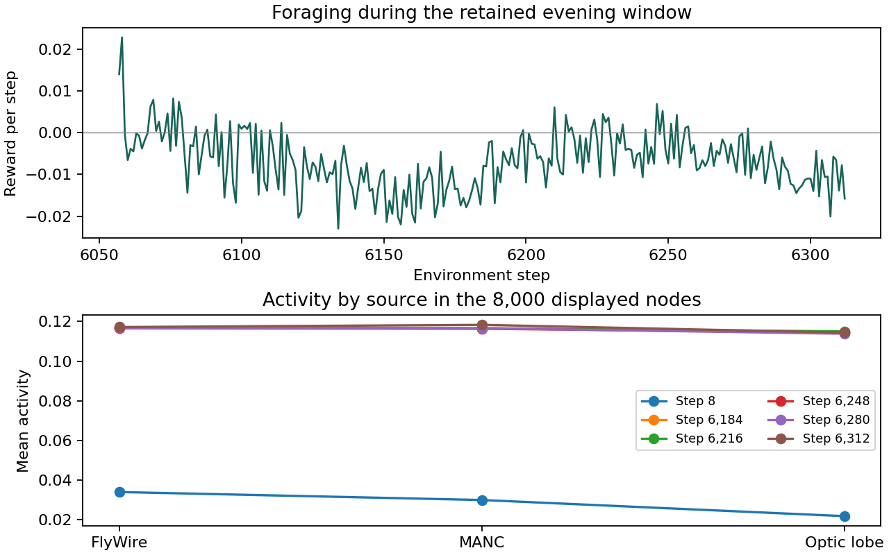

# Structural plasticity and forage performance in a 9,000-neuron Sonapse run

**Single-run observational report · Sonapse-LAB · 24 November 2026 · UTC**

## Abstract

A Sonapse agent operating on three sampled Drosophila connectomes completed 14 forage episodes without reaching the task's success criterion by environment step 6,312. The agent changed recurrent graft weights, repeatedly modified weak synapses and learned to predict one-step state changes. Reward prediction remained weaker than its baseline in the late observations. Over 64 evening steps the magnitude of a dopamine-like signal grew by more than six orders of magnitude while mean graph activity stayed near 0.116. It reached -4.39e41 before a recorded timeout and returned to -0.283 twelve steps into the next episode. At the observed hunger level, the gain and decay terms in the implementation predict the measured growth rate. This supplies a specific feedback mechanism to test. The evidence supports ongoing adaptation inside the model, with no observed improvement in completed forage outcomes. A separate six-task curriculum attached to the same session measured short-horizon returns and supplied no completed training episodes.

## Run and observation protocol

The server process began at 11:17:50 UTC with the Frontier options enabled and output directed to `outputs/live-8765`. The Max Mode tandem receipt identifies run `0dcaca0a-2b33-464c-9af6-47cd74d3e014` and reports 1,332.554 seconds of assay time. Its step-8 state and the checkpoint saved at 11:44 provide the early observation. Five read-only state requests returned steps 6,184, 6,216, 6,248, 6,280 and 6,312 at 20:02:03, 20:03:29, 20:04:51, 20:06:14 and 20:07:35. These times mark collection, with requests served at available simulation boundaries. The wall-clock span includes initialization, assays and any idle periods. The analysis issued no simulation controls. All six observations reported identical configurations.

The run used seed 7, eight CPU threads, PyTorch 2.11.0+cpu, four microsteps, a cognition interval of four and a persistent-evoked readout. The hybrid planner used a five-step horizon and surprise memory. Structural learning, active training, the neural graft, DSAG, NeuroWeave and Frontier observers were enabled. The auxiliary graft used batch size 256 and four configured updates. The three-source total of 9,000 sets the actual population despite the generic configuration field `nodes_per_source=100`. The full runtime configuration appears in Appendix A. Channel enablement describes availability. The state reported no live camera input at the sampled boundaries.

The world retains up to 50 terminal success flags per task. The state endpoint exposes only the latest 128 reward rows. We joined overlapping rows by step after verifying equality. The early eight rows and the 256 consecutive evening rows cover 264 distinct transitions through step 6,312. The interval from step 9 through 6,056 lacks a step-by-step reward trace in these captures. Cumulative counters retain some information across that gap. The single checkpoint belonged to the early state. Its sidecar digest matched the tandem receipt. The development-study JSON matched the copy inside the tandem receipt, and all 111 accompanying NPZ files matched their recorded SHA-256 hashes. The checkout contained local code changes, so its Git revision alone cannot reproduce the loaded process.

## The sampled connectome

| Component | Sampled neurons | Induced edge records | Anatomical synapse counts | Sampling seed |
|---|---:|---:|---:|---:|
| FlyWire v783 | 3,000 | 155,873 | 674,024 | 7 |
| MANC v1.0 | 3,000 | 217,960 | 1,379,212 | 108 |
| Right optic lobe v1.1 | 3,000 | 108,583 | 419,492 | 209 |

The builder selected role-stratified samples from high-degree candidates. The 482,416 source edges formed the frozen backbone. The model converted counts using signed log weights, assumed transmitter effects and incoming normalization. Anatomical counts therefore constrain the simulation without measuring synaptic efficacy. All 3,000 optic-lobe nodes had the visual role. MANC supplied 2,346 central, 369 ascending, 149 descending, 72 motor and 64 sensory nodes. FlyWire supplied 1,668 central, 1,170 visual, 120 descending, 40 ascending and two motor nodes. A separate auxiliary graft bound a 128-node MaleCNS sample with 1,585 edges. Its nodes are outside the 9,000-node total.

The main graph exposed 15,968 allocated graft slots. At the evening structure reading, the routing mask selected 9,578, yielding 491,994 base-plus-enabled edge records. The structural-learning module counted slots whose absolute weights passed a pruning threshold, a different measurement. That count was 15,968 at step 8 and 15,963 at step 6,248. The observatory's schematic coordinates and six role-based flow curves do not measure causal transmission.

## Changes in activity and connectivity

| Environment step | Mean graph activity | Above-threshold graft slots | Cumulative sprouted / pruned counts | Effective rank of 64 features | Dopamine-like signal |
|---:|---:|---:|---:|---:|---:|
| 8 | 0.02807 | 15,968 | 0 / 0 | warm-up | -0.0316 |
| 6,184 | 0.11611 | 15,962 | 115 / 9,682 | 4.407 | -1.02e+32 |
| 6,216 | 0.11629 | 15,962 | 115 / 9,874 | 3.933 | -1.65e+35 |
| 6,248 | 0.11592 | 15,963 | 115 / 10,052 | 4.434 | -2.69e+38 |
| 6,280 | 0.11592 | 15,963 | 115 / 10,212 | 4.944 | -4.39e+41 |
| 6,312 | 0.11678 | 15,963 | 115 / 10,372 | 5.398 | -0.283 |

Across the early and step-6,216 graph displays, 2,345 directed endpoint pairs appeared exactly once in each bounded graft list. Of these, 2,343 changed weight by more than 0.000001. The median absolute change was 0.000847. Each display contains at most 2,400 visible active graft rows, so disappearing endpoints cannot establish deletion. The pruning routine can weaken the same below-threshold slot repeatedly. Its 10,052 cumulative counts at step 6,248 therefore cannot be read as 10,052 distinct connections removed. The module reported 41 sprouting events and 115 sprouted slots.



**Figure 1.** The upper panel shows the retained evening reward sequence. The lower panel averages the same deterministic 8,000-node display sample by source at each observation. At step 6,184 all three source means fell between 0.1146 and 0.1168. The independent 9,000-node activity view at episode tick 366 reported a mean of 0.1163 and a maximum of 0.4328.

The 128-step plasticity monitor found effective rank 4.434 across 64 features at step 6,248. Forty-five features had low variance, and its cumulative collapse-alarm count reached 6,239. Continual backpropagation had recorded 768 unit replacements. These are features and counters at different levels of the model. The data do not establish loss of 70% of the graph's neurons. The Frontier functional-connectivity observer last computed its step-6,216 report at observer tick 6,528. Among 32 analysed units it found three correlation communities, mean absolute functional connectivity 0.374 and one dynamic state across 15 windows. This small, autocorrelated sample offers no evidence of a transition between distinct functional states.

The strongest instability appeared in the legacy dopamine channel. Its magnitude increased about 1,630-fold in each of two successive 32-step intervals. The endocrine composite reported exactly -1 at both later boundaries. The structural module also received an extreme input. At step 6,248 its last event recorded -1.50e38 alongside calcium 0.365. Activity and actions were still finite at that boundary. The legacy value reached -4.39e41 at step 6,280 and returned to -0.283 at step 6,312, after the step-6,300 timeout. That timing is consistent with an episode reset. The captures do not resolve the precise step of recovery. These measurements localize the anomaly to specific signals, but the observations cannot identify its origin or its effect on behavior.

### Why the dopamine excursion grew so quickly

The four pre-timeout samples all reported hunger 1.0, energy 0.0, stamina 1.0, zero food consumed and zero hazard hits. The legacy dopamine magnitude grew by factors of 1,629, 1,629 and 1,629 across the three 32-step intervals (rounded). The corresponding per-step factor is 1.26. An arbitrary large sensor reading would not by itself explain this regularity.

In the inspected implementation, the homeostasis module multiplies legacy dopamine by (1 + 0.8 × hunger), and the agent writes the product back into the legacy state. The transition update retains 0.70 of the previous value and adds a bounded reward-prediction-error term. With one application of each update per step at hunger 1.0, the coefficient on the old value is 1.8 × 0.70 = 1.26. Once the old value dominates the bounded input, the predicted magnitude ratio over 32 steps is 1.26³² ≈ 1,628.76. A negative value grows more negative under this recurrence. The coefficient exceeds one whenever hunger exceeds about 0.536 under these assumptions. The bounded endocrine composite is a separate output, so its saturation can coexist with growth in the stored legacy state.

This is a quantitative explanation consistent with the traces. Exact loaded source identity and intermediate values were unavailable. At step 6,312, hunger still read 1.0 while legacy dopamine was back near zero. A change of initial state at the episode boundary could produce that pattern even if the subsequent gain stayed high. Whether the large internal value altered any action remains an open question. The relevant repository modules are `synapse/homeostasis.py`, `synapse/neuromodulation.py` and `synapse/agent.py`.

## Environment outcomes and learning

At step 6,248 the forage world was 398 steps into episode 13, using zero-based episode numbering. Thirteen 450-step trajectories account for the preceding 5,850 steps. The success history covered all 13 completed episodes and averaged zero. The current episode had accumulated -2.329 reward. Step 6,300 then recorded an explicit timeout. At the observation cutoff, twelve steps into the next episode, the live and terminal counters supported 0 successes in 14 completed episodes. Across the 256 recovered evening steps, 44 rewards were positive and the sum was -1.726. Movement and occasional positive rewards thus coexisted with repeated failure to complete the task. Other tasks in the live world's success history had no observations.

Prediction improved selectively. At step 6,216 the model's prequential state-delta RMSE was 0.00557 against 0.02136 for predicting no change. The recent reward RMSE was 0.00789 against its baseline of 0.00634. The reward gate declined planning and the actor supplied the action. The auxiliary graft had processed 6,232 samples, including pretraining, and recorded 1,560 optimizer updates with zero actor updates. In its initial 16-transition pretraining phase, prediction loss fell from 0.05752 to 0.01665. At step 6,248 surprise memory held 30 entries following 1,020 writes and 990 replacements. At step 6,216 the reconsolidation module had recorded 25 reactivations and zero updates. Each of these measurements describes an internal change or a prediction outcome. None demonstrates improved goal completion.

### What the final episode and the prediction gates reveal

The return of the last completed episode can be reconstructed despite its missing early reward rows. The episode accumulator stood at -2.47150 at step 6,280. Adding the next 20 retained rewards, including the timeout reward, gives a full episode return of -2.66247. Its last 244 steps contributed -1.59511 and contained all 44 positive rewards in the recovered evening window. The next episode opened with 12 nonpositive rewards totaling -0.13100. This establishes that positive step rewards were possible without recording a successful terminal outcome. The archive lacks the full target-distance trajectory needed to distinguish failure to approach from repeated near misses.

For each evening snapshot we divided recent model RMSE by its same-snapshot baseline RMSE. A ratio below one favors the predictor. The five observations use overlapping histories and should be read as repeated views of one trajectory.

| Step | Reward RMSE ratio | State-change RMSE ratio | Graft optimizer / actor updates |
|---:|---:|---:|---:|
| 6,184 | 2.12 | 0.049 | 1,552 / 0 |
| 6,216 | 1.24 | 0.053 | 1,560 / 0 |
| 6,248 | 1.27 | 0.053 | 1,568 / 0 |
| 6,280 | 1.18 | 0.062 | 1,576 / 0 |
| 6,312 | 1.50 | 0.078 | 1,584 / 0 |

The reward predictor lost to its baseline at all five boundaries, and the planner gave the same reason for declining each time. The state predictor beat persistence at all five. Between steps 6,184 and 6,312 the graft added 32 optimizer updates and zero actor updates. A planner needs a way to rank actions by their consequences. Accurate forecasts of small state changes and frequent auxiliary updates alone did not supply that evidence. The captures establish the gate decision at those five instants. They cannot recover every intervening decision.

### Six-task curriculum

The earlier tandem curriculum trained for two steps per stage. It evaluated isolated clones with learning disabled, reset physiology and one fixed world seed per task, capped at two steps per evaluation. Across repeated evaluations the receipt counted 138 evaluation steps. Each training stage completed zero episodes, leaving success rates undefined.

| Task | Training-stage mean return | Matched stage baseline | Final evaluation return |
|---|---:|---:|---:|
| forage | -0.00182 | -0.02093 | -0.01699 |
| maze | -0.01789 | -0.01868 | -0.02133 |
| push | -0.00906 | -0.01678 | -0.01724 |
| delayed match | -0.01000 | -0.01000 | -0.01000 |
| ecosystem | -0.01425 | -0.02079 | -0.02222 |
| continental biosphere | -0.02355 | -0.02680 | -0.02659 |

Forage had the largest positive baseline-to-final change (+0.00394). Maze deteriorated by 0.00265. Delayed match stayed at -0.01000. The receipt's retention score of 0.99965 measures clipped positive return drops relative to acquisition, with a denominator of at least one. Small absolute changes over two steps naturally produce scores near one. The run recorded six sleep cycles and discovered zero curriculum skills.

A separate six-arm development assay trained for four transitions per stage on forage, push and ecosystem, then evaluated matched clones with a 60-step cap. Mean returns were -0.9480 for the frozen actor, -0.9487 for online reward-modulated learning, -0.8472 for actor replay, -0.9487 for continual backpropagation, -0.9487 for connectome evolution and -0.8472 for the combined system. The combined arm gained 0.1008 over frozen and tied replay alone at reported precision. A synthetic cue-memory study with one lineage found a recursive-minus-fixed difference of 0.0 and supplied no lineage interval. The live patch screen rejected its candidate, the RSI screen accepted zero candidates and the transplant assay did not support a causal donor benefit.

The final evaluation matrix shows where the apparent replay advantage arose. Each cell below is the final-stage query return in a matched world. The right column subtracts frozen from replay. These final evaluations answer a different question from the mean across training stages reported above.

| Final query task | Frozen actor | Actor replay | Replay minus frozen |
|---|---:|---:|---:|
| Forage | -0.9546 | -0.3376 | +0.6170 |
| Push | -1.0339 | -0.9283 | +0.1056 |
| Ecosystem | -0.8554 | -0.8871 | -0.0317 |

The combined system reproduced the replay values on all three final queries at the recorded precision. Forage accounted for most of the gain, and ecosystem performance moved in the opposite direction. One short query per task gives insufficient evidence for a general replay benefit or for an added contribution from the combined mechanisms.

### Auxiliary ecology and runtime cost

The virtual biome maintained its own clock. At biome step 457 it contained 14 foragers and four predators. Its population increased from 13 at step 25 to 18 at step 75 and remained at 18 at subsequent 25-step observations through 450. It registered 18 births, nine deaths and a maximum generation of two. These population counters belong to the biome. A separate four-step evaluation of a copied Max Mode agent in the NeuroWeave ecology recorded zero food, zero collisions and zero total reward.

At environment step 6,216, the 128-sample timing window averaged 2.936 seconds per step (median 2.894, 95th percentile 3.545). Learning accounted for 2.284 seconds of the mean, action generation 0.630 seconds and the world update about 0.00145 seconds. The dedicated simulation-worker endpoint reported idle while the main runtime advanced between reads. Its counters cannot measure the duration of the main trajectory.

## Interpretation and data availability

This run supplies direct evidence of weight changes and a useful one-step dynamics predictor. The same trajectory supplies negative evidence on forage completion and reward-guided planning, and a numerical warning about the legacy dopamine signal. One seed, one long task and sparse early history leave the causal relationship between these observations unresolved. The embedded control assays used shorter budgets and different trajectories. They cannot identify which mechanisms caused the long-run outcome.

The supplement includes the retained rewards, sampled graft links, source counts and provenance, selected telemetry histories, curriculum matrix, per-arm outcomes and capture fingerprints. It permits verification of the reported comparisons without contacting the running server. [Observation supplement](observations.json)

## What to try next

The first two experiments address distinct questions. One asks whether the internal signal can be stabilized. The other asks what prevents a successful forage episode. Both can be run on isolated copies, using the saved step-8 checkpoint as a shared starting point. The designs below are proposals. This report contains no outcomes from them.

### 1. Reproduce the feedback loop before changing the agent

Replay an identical recorded or scripted sequence of hunger and reward-prediction errors through the legacy update. Compare the original write-back with a variant that applies hunger gain only to the downstream readout. Include constant hunger below and above 0.536 and an episode reset. Log the stored value before and after each update, the composite value and the first nonfinite value, if any. The prediction is specific: sustained hunger 1.0 should yield a log-magnitude slope near log(1.26) per step once the additive input is small. Failure to reproduce that slope would require revisiting the update order or identifying another writer. If the isolated replay confirms it, compare both variants in matched closed-loop forage episodes. A bounded signal would establish a numerical improvement. A behavioral improvement requires a separate difference in success or return.

### 2. Find where a forage attempt breaks down

Run the frozen checkpoint actor, the ordinary learning agent and a simple target-seeking reference controller from identical starting worlds for the full 450-step limit. The reference tests whether the target and success condition are reachable. Log initial and minimum target distance, time within reach, contact attempts, successful consumption, action source, episode return and terminal reason. Persist a compact record at each episode end. If the reference succeeds and the agent rarely comes within reach, investigate navigation and target sensing first. If the agent reaches the target repeatedly and times out, inspect contact and reward assignment. Report success counts with episode denominators on held-out layouts.

### 3. Test whether reward prediction can support action selection

On fixed histories, compare the current predictor, its existing reward baseline and a predictor trained to estimate goal contact separately from step reward. Score approach, contact and ordinary movement separately and preserve their natural frequencies in the aggregate. Evaluate on whole held-out episodes so overlapping windows cannot leak between fitting and scoring. Then compare actor-only control with the existing gated planner and the revised predictor under the same planner budget. Record gate-open frequency, candidate action rankings and realized return. Prefer a change only if it improves held-out reward prediction and the resulting policy improves full-episode outcomes. Opening the gate more often is insufficient.

### 4. Separate the value of replay from that of rewiring

Use a two-by-two design with actor replay on or off and structural remodeling on or off. Match initial weights, environment seeds, transition budgets and evaluation horizons. Record optimizer work and wall time separately, since the observed learning stage dominated runtime. Track graft slot identity, directed endpoints, mask membership and weight before and after each structural event. Those records distinguish repeated weakening from a distinct connection replacement. Evaluate forage, push and ecosystem separately after each training stage and again after the final stage. A reproducible replay effect with no additional remodeling benefit would favor the simpler replay configuration for those tasks. A remodeling effect confined to one task warrants a task-specific conclusion.

### Evidence needed for a follow-up claim

Use independent agent seeds with paired world seeds across conditions. Fix the primary endpoint, evaluation budget and held-out layouts before comparing variants. Report paired differences by seed in full-episode success and return, with uncertainty across independent seeds and raw counts for each task. Treat feature rank, replacement counts, dopamine magnitude and community structure as secondary mechanism measurements. Preserve the exact source revision and local patch, effective configuration, checkpoint digest and episode summaries. This would let a follow-up distinguish a repaired numerical signal, a better predictor and an agent that actually reaches more goals.

## Appendix A. Runtime configuration

The following is the complete effective configuration returned by the running process at the sampled boundaries. Nested objects specify gains, dimensions, intervals, enabled mechanisms and seeds.

<details>
<summary>Show all 101 top-level settings</summary>

```json
{
  "seed": 7,
  "nodes_per_source": 100,
  "microsteps": 4,
  "cognition_interval": 4,
  "readout": "persistent_evoked",
  "task": "forage",
  "experience_planning": true,
  "surprise_memory": true,
  "experience_horizon": 5,
  "experimental_cognition": true,
  "continual_backprop": true,
  "fast_weight_memory": true,
  "dormant_lifecycle": true,
  "latent_reasoning": true,
  "value_guided_planning": true,
  "self_model": true,
  "frontier_all": true,
  "planner_algorithm": "hybrid",
  "connectome_sources": [
    "flywire",
    "manc",
    "optic-lobe"
  ],
  "total_neurons": 9000,
  "neural_graft": true,
  "active_training": true,
  "programmed_connectome": true,
  "compute_threads": 8,
  "graft_batch_size": 256,
  "graft_updates": 4,
  "connectome_mode": "prefer_authentic",
  "structural_learning": true,
  "dendritic_ltc": true,
  "oscillatory_coherence": true,
  "verifiable_dpo": true,
  "dvgem_memory": true,
  "tether_coordinator": true,
  "criticality_homeostat": true,
  "holographic_vsa": true,
  "apical_amplification": true,
  "spectral_reservoir": true,
  "hyperbolic_manifold": true,
  "spiking_neuromorphic": true,
  "glymphatic_clearance": true,
  "quantum_kuramoto": true,
  "archimedes_buoyancy": true,
  "memory_carrier_nexus": true,
  "cross_connectome_graft": true,
  "aether_graft_bridge": true,
  "aether_bridge_gamma": 0.25,
  "aether_bridge_modes": 16,
  "aether_bridge_control": "none",
  "graft_bus_enabled": true,
  "neural_comm_enabled": true,
  "neural_comm_mode": "continuous",
  "neural_comm_dim": 32,
  "neural_comm_precision_bits": 4,
  "neural_comm_every": 1,
  "neural_comm_max_messages": 4,
  "neural_comm_max_bits": 128,
  "neural_comm_max_aux_current": 0.5,
  "neural_comm_topology": "hybrid_causal",
  "neural_comm_drop_rate": 0.0,
  "neural_comm_latency_steps": 0,
  "neurowave_enabled": true,
  "overflow_mini_brain": true,
  "grafted_diffusion": true,
  "selective_state_space": true,
  "multitimescale_learning": true,
  "meta_plasticity": true,
  "causal_world_model": true,
  "relational_memory": true,
  "verifier_rsi": true,
  "event_driven_backend": true,
  "graph_diffusion": true,
  "active_inference_planner": true,
  "thermodynamics": true,
  "metaplasticity_bcm": true,
  "transfer_entropy": true,
  "neurowave_x2_enabled": true,
  "neurowave_x2_gamma": 0.25,
  "neurowave_x2_protocol": "adaptive",
  "neurowave_x2_dimension": 32,
  "neurowave_x2_precision_bits": 32,
  "neurowave_x2_spectral_modes": 16,
  "neurowave_x2_spectral_basis": "hybrid",
  "neurowave_x2_phase": true,
  "neurowave_x2_plasticity": true,
  "neurowave_x2_development": true,
  "neurowave_x2_development_level": 6,
  "neurowave_x2_dendritic": true,
  "neuroendocrine": true,
  "synthetic_glands": true,
  "affective_core": true,
  "neural_pulses": true,
  "sleep_replay": true,
  "shared_knowledge": true,
  "live_microphone": true,
  "live_chat": true,
  "virtual_ecology_v2": true,
  "cross_model_exchange": true,
  "evo_compat": true,
  "dsag": {
    "version": 1,
    "enabled": true,
    "observe_only": false,
    "gain": 0.025,
    "max_gain": 0.1,
    "ramp_steps": 32,
    "seed": 7,
    "soma_dim": 8,
    "segment_count": 4,
    "branch_segments": [
      1,
      3
    ],
    "max_branches": 8,
    "branch_delays": [
      0,
      0
    ],
    "segment_delay": 0,
    "context_dim": 64,
    "message_dim": 32,
    "eta_soma_a": 0.5,
    "eta_soma_b": 0.25,
    "eta_branch": 0.5,
    "eta_axon": 0.5,
    "eligibility_decay": 0.9,
    "plasticity_rate": 0.001,
    "plasticity_decay": 0.0001,
    "plasticity_enabled": true,
    "phase_gate_enabled": true,
    "richer_messages": true,
    "dual_soma": true,
    "axo_branches": true,
    "structural_growth_enabled": true,
    "packet_ttl": 64,
    "max_queue": 256,
    "packet_loss_policy": "no_event",
    "target_indices": null,
    "parent_commit": null
  },
  "neuroweave": {
    "enabled": true,
    "observe_only": false,
    "gain": 0.02,
    "max_gain": 0.1,
    "ramp_steps": 32,
    "seed": 7,
    "neurons": 256,
    "topology": "dense_multi_region",
    "sparsity": 0.15,
    "tile_size": 16,
    "fan_in": 6,
    "inhibitory_fraction": 0.2,
    "max_neurons": 512,
    "max_synapses": 12288,
    "structural_interval": 25,
    "sleep_interval": 100,
    "micro_experts": 4,
    "micro_top_k": 2,
    "ecology": "default",
    "mechanisms": [
      "multi_soma",
      "structural_encoder",
      "sparse_code",
      "associative_memory",
      "reward_plasticity",
      "synaptic_delays",
      "homeostatic_governor",
      "tiled_execution",
      "context_attention",
      "flyhash_projection",
      "neuromodulator_field",
      "structural_plasticity",
      "sleep_consolidation",
      "predictive_ensemble",
      "adaptive_conduction",
      "quantised_synapses",
      "axonal_branches",
      "fast_weights",
      "efference_self_model",
      "predictive_coding",
      "stdp",
      "adaptive_routing",
      "hierarchical_temporal_memory",
      "uncertainty_gating",
      "multimodal_sensory",
      "affective_modulation",
      "micro_collective",
      "expert_routing",
      "meta_plasticity",
      "predictive_replay",
      "transmitter_inference",
      "dendritic_compartments",
      "extended_somas",
      "membrane_dynamics",
      "astrocyte_regulation",
      "receptor_heterogeneity",
      "multi_region_routing",
      "neurogenesis",
      "memory_ecology",
      "hierarchical_prediction",
      "counterfactual_prediction",
      "cross_modal_memory",
      "specialist_graft",
      "representation_fusion",
      "q88_state"
    ],
    "sensory_modes": [],
    "schema": "NeuroWeaveSpecV1",
    "schema_version": 1
  },
  "frontier": {
    "enabled": true,
    "seed": 7,
    "modules": [
      "synchrony",
      "kuramoto_binding",
      "sparse_dictionary",
      "connectomics",
      "causal_emergence"
    ],
    "observe_every": 1,
    "max_observed_units": 256,
    "history": 256,
    "sae_features": 64,
    "sae_k": 8,
    "sync_pairs": 64,
    "fc_window": 128,
    "graft_optimizer": "adam",
    "schema": "FrontierSpecV1",
    "schema_version": 1
  }
}
```

</details>
