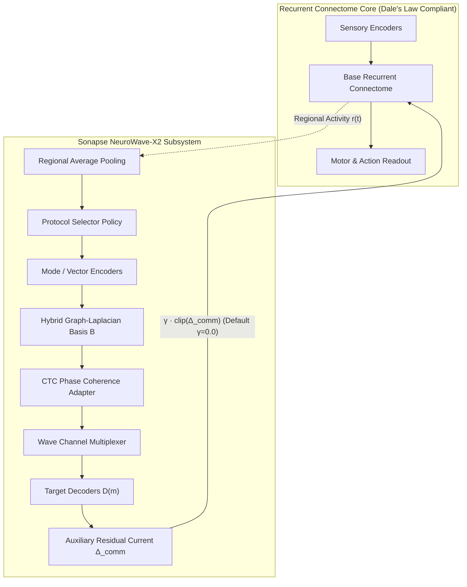

# Sonapse NeuroWave-X2 — Architectural Design & Specification

## 1. Executive Summary & Objective

**Sonapse NeuroWave-X2** is an advanced, non-destructive, additive neural communication research platform integrated directly into Sonapse-LAB. It evolves inter-module communication from scalar point-to-point residual channels into a structured, phase-aware, topology-governed spectral fabric while strictly maintaining bit-for-bit backward compatibility with existing connectome simulations, neural grafts, and active training loops.

---

## 2. Mathematical Foundations

### 2.1 Graph-Laplacian Spectral Basis
Given the active inter-region communication graph adjacency matrix $A \in \{0, 1\}^{N \times N}$, the degree matrix $D = \text{diag}(d_1, \dots, d_N)$ with $d_i = \max(1, \sum_j A_{ij})$ defines the symmetric normalized Laplacian:
$$L = I - D^{-1/2} A D^{-1/2}$$
Because $L$ is symmetric positive semi-definite, it admits an orthonormal eigendecomposition:
$$L = U \Lambda U^\top, \quad 0 = \lambda_0 \le \lambda_1 \le \dots \le \lambda_{N-1} \le 2$$
The eigenvectors $u_k$ corresponding to the lowest non-zero eigenvalues represent smooth harmonic carriers along the communication topology.

### 2.2 Hybrid Biological + Learned Basis
To accommodate learned communication demands while preserving biological structure, NeuroWave-X2 uses QR deflation:
$$B_{\text{hybrid}} = \text{orthogonalize}([B_{\text{graph}}^\top, B_{\text{learned}}^\top])^\top$$
where $B_{\text{graph}}$ spans connectome-derived carriers and $B_{\text{learned}}$ provides orthogonal task-specialized degrees of freedom.

### 2.3 Non-Negative Communication-Through-Coherence (CTC)
Gating between transmitting region $i$ and receiving region $j$ is governed by oscillatory phase alignment:
$$g_{ij}(t) = \frac{1 + \cos(\theta_i(t) - \theta_j(t))}{2} \in [0.0, 1.0]$$
Because $g_{ij}(t) \ge 0$, auxiliary residual injection cannot invert excitatory/inhibitory signs, strictly preserving **Dale's law**.

### 2.4 Wire Accounting & Zero-Gain Guarantee
Total state update:
$$h_{t+1} = f(h_t, x_t) + \gamma \cdot \text{clip}(\Delta_{\text{comm}}(t), -c, c)$$
When $\gamma = 0.0$ or when NeuroWave-X2 is disabled (`neurowave_x2_enabled=False`), the auxiliary term is identically zero:
$$\lim_{\gamma \to 0} h_{t+1} \equiv f(h_t, x_t)$$
This provides a mathematical and numerical guarantee of zero regression.

---

## 3. Communication Protocols Hierarchy

NeuroWave-X2 organizes communication into 9 standardized protocols mapped across developmental complexity levels 0 to 6:

| Protocol ID | Level | Description | Payload Encoding | Precision |
| :--- | :---: | :--- | :--- | :---: |
| `no_comm` | 0 | Pure isolation baseline | None (0 bits) | 0-bit |
| `scalar` | 0 | Single scalar scalar gating | Scalar float | 8/16-bit |
| `vector` | 1 | Standard dense activation vector | Dense float tensor | 16/32-bit |
| `quantized` | 2 | Uniform integer quantized vector | Quantized codebook | 4/8-bit |
| `attention` | 3 | Key-value routed multi-head message | Multi-head tensor | 16-bit |
| `spectral` | 4 | Graph-Laplacian harmonic projection | Eigen-coefficients | 16-bit |
| `phase` | 4 | Phase-locked oscillatory gating | Modulated vector | 16-bit |
| `phase_spectral` | 5 | Joint spectral multiplexing + CTC | Hybrid wave packet | 16-bit |
| `phase_spectral_dendritic` | 6 | Joint wave packet + non-linear dendritic integration | Structured packet | 32-bit |

---

## 4. Transactional Plasticity & Rollback Guarantees

All structural rewiring and topology mutations operate within a two-phase transactional boundary (`TopologyTransaction`):
1. **Prepare Phase**: Full clone of topology adjacency, spectral basis caches, model weights, buffers, and optimizer momentum moments (`exp_avg`, `exp_avg_sq`).
2. **Execute & Validate**: Prospective route mutations are evaluated on validation benchmarks.
3. **Commit or Rollback**: If validation fails or resource quotas are exceeded, state is atomically restored without lingering side-effects.
