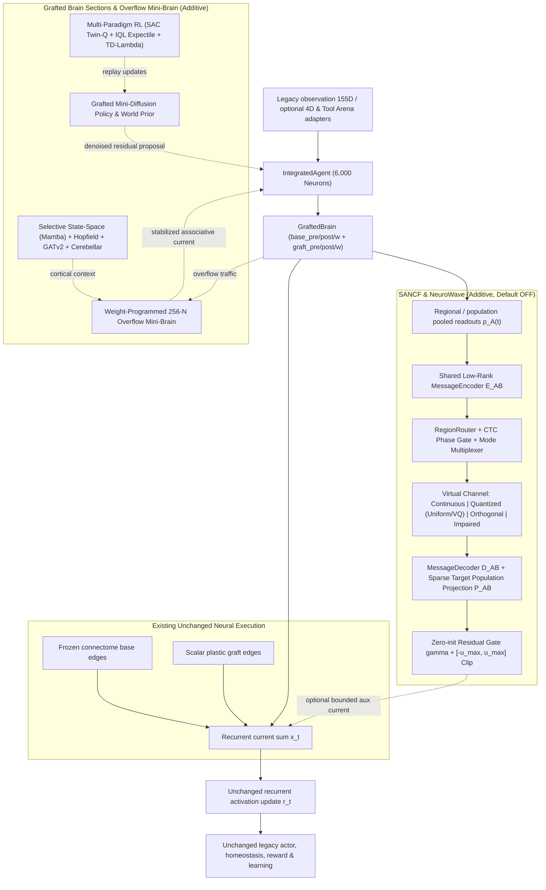
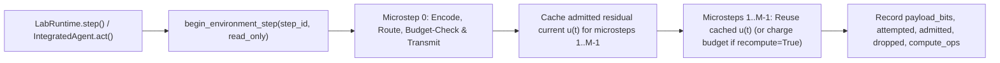
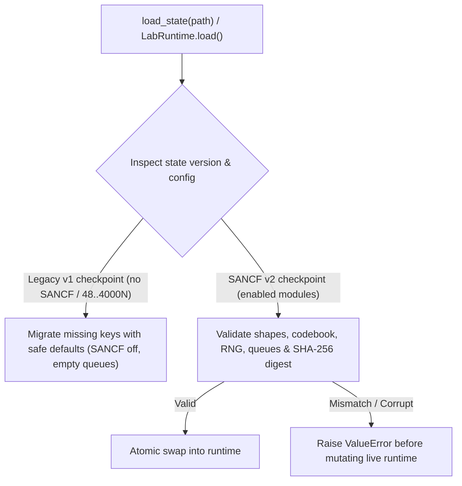

# SANCF — Sonapse Adaptive Neural Communication Fabric & Frontier Architecture Design

**Date:** 2026-11-07  
**Baseline Commit:** `880bb4a0da05ca783738a16723b0a629f14e5517`  
**Default Neuron Scale:** `6,000` (`2,000` FlyWire + `2,000` MANC + `2,000` Optic-Lobe + `128` MaleCNS prior + `256` Weight-Programmed Overflow Mini-Brain + memory-mapped access to all 562,137 verified neurons on disk)

---

## 1. Core Architectural Invariant & Non-Regression Guarantee

For every recurrent microstep $m \in \{0, \dots, M-1\}$ inside `GraftedBrain.forward()`:

$$x_t^{(m)} = \underbrace{\operatorname{index\_add}(0, \text{base\_post}, w_{\text{base}} \odot r_t^{(m)}[\text{base\_pre}])}_{\text{Unchanged frozen biological edges}} + \underbrace{\operatorname{index\_add}(0, \text{graft\_post}, w_{\text{graft}} \odot r_t^{(m)}[\text{graft\_pre}])}_{\text{Unchanged scalar plastic graft edges}} + b + d_t + \begin{cases} u_{\text{SANCF}}(r_t^{(m)}, m) & \text{if SANCF enabled} \\ 0 & \text{if SANCF disabled} \end{cases}$$

- **Exact Off-Path Equivalence:** When `neural_comm_enabled=False` and `neurowave_enabled=False`, `comm_fabric` is not invoked, zero random numbers are drawn, and `GraftedBrain.forward()` executes the exact legacy code path bit-for-bit.
- **Zero-Gate Initialization:** When SANCF is enabled, its residual gain $\gamma$ is initialized to **exactly `0.0`** so initial outputs match the unmodified baseline until explicit training or user configuration warms $\gamma$ within $[-\gamma_{\max}, \gamma_{\max}]$.
- **Evoked Readout Safety:** Baseline runs inside `prepare_observations` or evoked-channel subtraction pass `advance=False, adapt=False`, which never mutates message queues, RNG state, optimizer state, or step counters.

---

## 2. Two-Clock Simulated-Time & Capacity Accounting

- **Environment Clock vs Microstep Clock:** `communication_every` is measured in **environment steps** (`agent.ticks`).
- **`begin_environment_step(step_id, read_only=False)`:** Opens an accounting window for step `step_id`. By default (`recompute_per_microstep=False`), messages are encoded and budgeted at `microstep == 0` and cached for `microstep > 0`. If `recompute_per_microstep=True`, every microstep encoding is charged against the same `max_payload_bits_per_tick` budget.
- **Strict Read-Only Contract (`advance=False` / `read_only=True`):** Never mutates delay queues, local RNG, codebook EMA, or cumulative telemetry counters.

---

## 3. Tensor Shapes, Parameter Budget & Failure Modes

| Component | Input Shape | Output Shape | Parameter Scaling | Failure Mode & Guard |
| :--- | :--- | :--- | :--- | :--- |
| `RegionPooler` | `r: [N]`, `origin: [N]`, `role: [N]` | `p_A: [R, K_pool]` (`K_pool=32`) | $\mathcal{O}(R \cdot K_{\text{pool}})$, no $\mathcal{O}(N^2)$ | Empty region $\rightarrow$ zero vector; NaN/Inf $\rightarrow$ zeroed + flagged |
| `MessageEncoder` | `p_A: [K_pool]`, `region_emb: [16]` | `m_AB: [D]` (`D \in \{1..64\}`) | Shared MLP `(48 -> 64 -> D)` | Pre-LayerNorm + `tanh` bounds latent amplitude $\le 1.0$ |
| `ChannelProtocol` | `m_AB: [D]` | `\hat{m}_{AB}: [D]`, `bits: int` | VQ codebook `[C, D]` (`C \le 256`) | Budget overflow $\rightarrow$ suppress message & increment `dropped_messages` |
| `MessageDecoder` | `\hat{m}_{AB}: [D]`, `dst_emb: [16]` | `u_B: [|T_B|]` via low-rank basis | `(D+16 -> 64 -> K_target)` | Sparse index projection into designated `target_indices` only |
| `ResidualGate` | `u: [N]` | `\gamma \cdot \operatorname{clip}(u, -u_{\max}, u_{\max})` | Scalar/per-route $\gamma$ init `0.0` | Hard clamp `[-max_aux_current, +max_aux_current]`, Dale's law sign mask |
| `OverflowMiniBrain` | `region_latents: [R, 32]` | `overflow_out: [32]`, `rates: [256]` | `256x256` Dale-signed recurrent matrix | Spectral radius normalized $\le 0.95$; overflow gate activates on load |
| `MiniDiffusionModel` | `state: [48]`, `noisy_act: [5]`, `t` | `denoised_act: [5]` | `(48+5+8 -> 64 -> 5)` score net | Bounded DDIM steps ($K=4$), clamped to `[-1, 1]` trust region |

---

## 4. Checkpoint Schema & Versioned Migration Policy

- Old checkpoints without `neural_comm`, `overflow_mini_brain`, `mini_diffusion`, or `multitimescale` keys load cleanly into disabled or migrated runtimes via `upgrade_checkpoint_payload()`.
- Any corrupted tensor, non-finite value, or shape mismatch raises `ValueError` **before** modifying `self.agent` or `self.world`.
