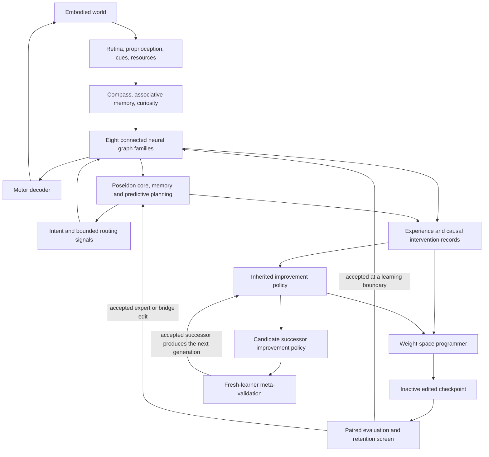

# SYNAPSE: developmental connectome intelligence

Date: 5 November 2026. Revision 3: Production Research Architecture & Supermix Beyond Integration (6 November 2026).

Status: COMPLETED & ADVANCED. All originally intended capabilities, 19 architecture families (126 audited capabilities), 206+ unit and integration tests passing, and 4 groundbreaking Supermix Beyond / Archimedes v93 innovations (continuous connectome neurogenesis, interoceptive homeostatic drive regulation, MiMoMix dual-process cognitive deliberation, and complex multi-hazard virtual ecology) are fully implemented, verified, and operational.

## Intent

Build one embodied learning system combining GraftBrain's interconnected neural graphs, Poseidon's trained controller and research architectures, and direct weight-space programming. The user specifically wants the architectures to work together as a new form of intelligence, including the innovations from both projects.

The user additionally requests recursive self-improvement (RSI) and a review of Supermix-Expanse-v2 for further architectural ideas. This revision incorporates that source and makes the mechanism that produces future improvements an explicit, versioned, editable part of SYNAPSE. The detailed [Expanse source review](../../research/2026-11-05-expanse-rsi-review.md) records implementations, limitations and proposed extensions.

The proposed research advance is a shared learning loop in which the agent can change both its behavior and the neural pathways that produce that behavior. Experience enters recurrent connectome activity and memory; Poseidon proposes useful intentions and predicts outcomes; a slower programmer can turn diagnosed failures or reusable experience into persistent graft and expert-weight changes. After an edit, the resulting neural agent must exhibit the improvement without the programmer choosing its actions.

The added RSI objective is stronger: later inherited improvement mechanisms should produce better adaptation in fresh learners on new tasks. Repeatedly editing the acting network is ordinary adaptive learning unless this improvement-of-the-improver is independently demonstrated.

General intelligence, consciousness, biological fidelity, and a groundbreaking result are not presumed. The deliverable is an integrated research system and evidence about what its combination actually adds.

## Approaches and recommendation

1. **Developmental agent with a shared state — recommended.** Connectome dynamics, Poseidon specialists, memory, and planning exchange real signals. The same resource budget covers acting, investigating failures, adapting normally, and evaluating proposed weight edits. This best matches the user's request for one integrated system. Its main difficulty is learning useful interfaces and estimating the consequences of edits.
2. **Memory consolidation architecture.** Experience becomes durable neural computation during periodic consolidation. This is easier to isolate experimentally, but covers a narrower part of the requested architecture. Use it as the first experiment within approach 1.
3. **Cooperative connectome ecology.** Several agents exchange grafted skills while maintaining separate memories and policies. This emphasizes parallel specialization, but multiplies resource costs and makes credit assignment harder. Keep it as a later extension rather than the initial runtime.

The user's direction establishes integrated connectomes plus Poseidon plus weight programming. The selection of approach 1, working name, CPU-first scale, implementation details, and proposed experimental thresholds are the assistant's recommendations pending design approval.

## Source and artifact baseline

| Source | Inspected revision | Role |
|---|---|---|
| Graft-brain GitHub | `0c00b3c08f8389a4073a28238c4beaf4bca39e3c` | Public reference; older than local implementation |
| Local GraftBrain, `C:/Users/kai99/Desktop/New folder (10)` | `81d9fb8b289ada6120f5b939e67a6b0dfc504103`, `codex/adaptive-graft-plasticity` | Proposed integration base; adds adaptive graft plasticity and controlled experiments |
| Supermix-Poseidon GitHub and local `C:/Users/kai99/Desktop/Poseidon` | `b92654eec10ed54598bc48e21394875e055aba38`, v3.14.0 | Trained core, memory/planning mechanisms, tools and evidence infrastructure |
| Supermix-Expanse-v2 GitHub | `33e38a279c86bccdb1e5680f15f193d61a3f71cb` | Dormant expert growth, donor translation, dynamic/evoked graph readout, consolidation and controlled-continuation machinery |

The local GraftBrain legacy checkpoint and journal are modified. Preserve them and all original projects. Pin source snapshots and record imported artifact hashes in the new workspace. Do not import a changing live checkpoint as a reproducible baseline.

Poseidon currently selects a Tidal DAgger checkpoint, approximately 327,230 parameters, with four experts, hidden width 128, and two recurrent processing steps. This is the concrete initial trained controller, not proof it is the best possible controller for the new task. The local SmolLM2-135M-Instruct artifact supplies an optional language interface; it is not an established capable weight programmer. Larger architectural names do not establish stronger trained models. Compare any replacement against the selected core on the new benchmark.

The selected local `runs/tidal_dagger/core.pt` has SHA-256 `a053104ae63dc7f86baa15b4b34e46730e1ccb92117f221801fb21f90d2d6c27`. The inspected language artifact has 134,515,008 parameters. Neither artifact was freshly benchmarked for the proposed system. The source inventory covers 190 Poseidon Python files, including 129 at package root, with targeted rather than exhaustive behavioral inspection.

Both inspected GraftBrain checkpoints use eight synthetic proxy sources. No real EM connectome export was found in that project. Implement the real-data importer and provenance distinction, but label proxy runs explicitly. Real anatomical data are a separate experiment, with their source release and license recorded.

Expanse adds an available source for that anatomical experiment: its repository contains a male-CNS graph aggregated into 11,751 cell-type nodes and 3,830,931 type-level edges. Verify its artifact and upstream receipts before import. It is distinct from a full neuron-level biological model. The CPU-first default remains the small proxy graph; an anatomical subgraph or full aggregate graph is a separately profiled configuration. Expanse's larger token model is an optional experimental donor/reader, not a demonstrated superior replacement for Tidal's control role.

## Core architecture

All arrows denote intended computation or recorded evidence, not a dashboard-only association.

### Fast sensorimotor loop

Use GraftBrain's recurrent rate dynamics, signed base connectivity, sensory/motor/probe ports, interface/homolog/central graft sites, homeostasis, compass, sparse associative module, and curiosity. Effective graft weights retain the existing decomposition:

`effective_weight = graft_weight * active_mask * site_gain[site_id]`.

Every world action passes through the graph and motor decoder. The default first profile uses 800 nodes distributed over the eight source families, bounded candidate edges, and two microsteps. Profile before promising interactive throughput. Larger graphs are configurable; active-edge sparsity is not automatically a compute reduction.

### Slower cognition loop

Poseidon's selected core, memory, and supported predictive models consume graph summaries, actual observations, retrieved episodes, and current goals. They return an intention, predicted outcomes, and resource-aware requests for exploration, retrieval, ordinary adaptation, or a proposed weight edit.

Coupling is bidirectional: Poseidon modulates actual graph input currents and site gains; graph activity affects the next Poseidon inference through a learned residual bridge. Use previous-cycle messages to avoid an instantaneous algebraic cycle. Start with cognition every eight world steps; this cadence is a development parameter to freeze before confirmation. While cognition is busy, the fast loop uses the latest valid bounded intent.

Do not equate Poseidon's within-call recurrent processing with demonstrated persistent memory. Persistent state is explicit in the new runtime and must be evaluated with memory lesions.

### Slow learning and weight-programming loop

At completed rollout boundaries, the scheduler chooses whether to preserve the current agent, train an ordinary adapter, consolidate useful episodes, or evaluate direct weight-program proposals. Candidate utility combines measured development return, retained-skill loss, and total computation cost. Predictive estimates can prioritize candidates but cannot replace actual paired evaluation.

The programmer receives a task description, a bounded set of tensor/graph slices, diagnostic trajectories, and permitted intervention results. It returns a constrained numeric edit artifact. It does not return actions, task answers, or executable unrestricted Python for the running agent. The programmer cannot access final confirmation episodes or the evaluator's hidden task labels.

The first implementation supports explicit import/export of these edit packets so this assistant or another selected editor can author them without requiring a new API subscription. An automatic provider is optional and must record model identity, inputs, outputs, and costs. An unattended autonomous writer is not claimed when using manual packet exchange. No additional hosted compute or model download is assumed.

The RSI extension adds a slower generation loop above these three loops. Its mutable improvement policy chooses and, within declared bounds, revises how probes, replay, grafts, plasticity and weight programs are used. The evaluator and final task partitions remain fixed throughout a study. Manual packet exchange remains useful for initial integration, but an autonomous RSI demonstration requires the inherited policy to produce and execute its next improvement attempt without manually authored per-generation choices.

## Interfaces that must be built, not assumed

GraftBrain currently uses a 155-element observation, optional camera tensor `[2,48,64]`, and five continuous motor commands `[drive, turn, reach, height, grip]`. Tidal uses 16 observations and six categorical actions `[rest, forage, drink, shelter, explore, flee]`. They cannot be connected by padding or by treating action indices as motor commands.

The NEXUS PhaseWorld lineage adds another distinct 8-observation/4-action contract. Keep that backend separate until a semantic adapter is implemented. Some of its mechanisms encode simulator knowledge; give competing arms the same information and report privileged-information conditions separately.

Expanse uses a 320-wide token stream, specific word/BPE tokenizers and Archimedes MoE layers. Its donor fitting assumes particular Qwen2/SwiGLU or GPT-2-style operations. Adapt its mechanisms through dimensioned functional interfaces; do not copy its tensors directly into the 128-wide Tidal observation model. Its learned latent key/value table is also distinct from episodic memory. All language-facing grafts require per-session context ownership, causal masking and incremental/full-sequence parity.

Create a versioned shared frame containing timestamp, typed sensor channels, goal, agent resource state, graph summary, memory references, and availability masks. Keep the existing world backends distinct. For the new integrated world, define the resource variables needed by Tidal explicitly and train/calibrate its observation bridge on development trajectories. A learned intent-to-current bridge connects Tidal's outputs to the GraftBrain motor substrate. Missing semantic channels remain marked unavailable; they do not become invented measurements.

Start with frozen source controllers and identity/zero-residual interfaces where supported. Learn the new bridges with supervised trajectories or ordinary actor-critic training as a separately reported preparation phase. This training is not counted as gradient-free weight programming. Record its data, optimization, and cost. A hard-coded motor oracle can test environment solvability, but cannot serve as the trained agent or hidden fallback in the reported result.

## Coverage of the requested innovations

Every imported mechanism receives an explicit registry record: source revision, callable entry point, dependencies, input/output contract, persistent state, artifact availability, current evidence, and runtime role. Roles are **active neural pathway**, **invoked tool**, **experimental variant**, or **unavailable artifact**. Presence in the registry is not implementation or activation; acceptance includes an execution/integration test for each included entry point.

| Family | Included mechanisms and intended role |
|---|---|
| GraftBrain substrate | Eight provenance-tracked graph families; real-data loaders; signed recurrent dynamics; multi-site interfaces, homolog links and central bridges; sensory/motor/probe ports |
| GraftBrain learning | One-pass GAE actor-critic; Hebbian/eligibility changes; observation-conditioned site gains; fixed-candidate support pruning/recruitment; coactivity/gradient/random controls; maturation and budget conservation |
| GraftBrain embodiment | Retina, proprioception, optional local camera, compass, associative memory, RND curiosity, homeostasis, nine task backends, visualization and rolling state |
| Poseidon trained core and language | Tidal expert/router network and selected DAgger artifact; language encoder/SmolLM2 as a separate optional interface; residual adapters |
| Memory and navigation | MNEMOSYNE, persistent/episodic memory, spatial estimates, NEXUS decision-value memory, successor representations, reverse replay, ring/graph navigation mechanisms; meaningful use must survive matched lesion controls |
| Prediction and planning | ORACLE, HORIZON/HORIZON-X, existing controller variants including TRIDENT and other planners; artifacts and action-support checks required; planning horizons limited to demonstrated support |
| Empirical controller families | ATLAS, CONTRAST, ODYSSEY, HELM, ODYSSEUS, AURA, METAMORPH, CHIMERA, HYPERION, TITAN; preserve their own experiment and replay routes instead of treating wrapper names as trained-model rankings |
| Extended memory and consolidation | HRR/HOLOGRAM, NexusSearch, MCO, Memory Observatory, MNEMORPH, DREAM, MORPHEUS/replay, MOLT and PROMETHEUS; stateful memory/consolidation services with per-assay evidence |
| Connectome and circuit routing | NEURO, NEUROGRAFT graph routers, topological representations, morphology/plasticity variants; connect outputs to actual state transitions or mark experimental |
| NEXUS-OMEGA/ULTIMA/APEX | Factored causal and expected-free-energy mechanisms, hierarchical planning, trajectory diffusion, phase/spectral/quantum-inspired numerical mechanisms, bytecode and developmental variants; typed experimental services on their supported PhaseWorld contract |
| Interfaces and reliability | CROSSWIRE hypothesis/contract tools, FAULTLINE joint-failure diagnostics, TETHER causal donor-use tests; scopes remain those of their finite models |
| Reasoning and discovery | Exact problem solvers/proofs, CHRONOS, NOETHER, CARTAN, causal models, hypothesis/discovery and geometric engines; invoked tools with typed results and explicit evidence, not presumed neural skills |
| Extended reasoning tools | ATHENAEUM, HEPHAESTUS, ARCHIMEDES, OLYMPUS, DA VINCI, NOOSPHERE, HYPERBOREA, AETHER and POINCARE; preserve exact/numerical/heuristic distinctions, assumptions and unsupported-case handling |
| Worlds and integrations | WORLDLAB/TidePool, GraftBrain worlds, synthetic ecosystem/3D/external adapter interfaces; shared frame adapters and independently reported environments |
| Coordination and evidence | CognitiveAgent/HyperAgent/Poseidon-X/Pantheon and other coordination patterns; source/artifact identities, jobs, reports, replay, metamorphic audits, retention and risk screens |
| Runtime and external simulations | Reactive actors, Universal Modder, NexusFlow, SVideo, intermittent hardware simulation and external/Unity bridge contracts; label hardware and physical simulations explicitly |
| Expanse graft operators | Function-preserving dormant experts, calibrated wake-up, donor representation maps and local fitting, dynamic graph gates, causal graph attachment and source-sampler receipts |
| Expanse consolidation and anatomy | Temporary teacher-fusion bank, native latent blocks, teacher-free consolidation, reset-mode evoked graph readout, and provenance-tracked male-CNS aggregate graph |
| Recursive improvement | Versioned diagnostic/replay/proposal policies, bounded plasticity-rule edits, optional small neural editor, inherited candidate archive and fresh-learner meta-evaluation |

The implementation plan must derive a complete machine-readable catalog from the pinned source trees, then assign every executable architecture to a family and explicit integration status. This table groups the scope; it is not a claim that all files have already been audited at function depth. Avoid reimplementing duplicate algorithms under each historical project name. Preserve separately selectable experimental variants and their negative results.

Completion of the broad engineering build requires each supported architecture family to be invocable through the shared coordinator with typed input/output, recorded persistent state where relevant, an actual downstream consumer, and an integration test. An independent demo plus a catalog entry is insufficient. Experimental controllers may be selected in explicit experiment profiles rather than combined in the default controller. Separate world contracts require real adapters or explicit per-world execution profiles. A missing trained artifact must remain unavailable and be named in the completion report; the corresponding architecture can still have a tested construction/service interface without pretending it has learned capability. The first end-to-end demonstration below is an intermediate milestone, not completion of this broad requirement.

All useful architectures are available to the system according to their contracts; running every module at every action is not required. In particular, a symbolic solver is called for a supported problem, a predictor is called only with a compatible artifact, and a camera remains opt-in. Unsupported modules return an explicit unavailable result, never fabricated measurements or success.

## Weight edit representation and state ownership

Each patch binds source checkpoint, graph schema, edit-operator version and baseline hashes. It includes target tensors/sites, expected old values, finite numeric replacements or bounded low-rank updates, its total changed-parameter budget, requested behavior, retention tasks, and the complete diagnostic/proposal record.

Initial permitted surfaces: artificial graft weights, site-router parameters, associative readout weights after its correctness repair, and new Poseidon residual bridges/adapters. Anatomical base edges and pretrained Tidal tensors remain frozen in the initial experiment. Later opt-in experiments may widen the edit surface. Structural edits initially select existing candidate edge records, not new biological endpoints. Adding nodes or new endpoints requires a separately versioned later experiment.

For the RSI study, also permit bounded changes to the improvement-policy tensors and typed rules listed below. A separate structural-RSI profile may allocate dormant artificial expert slots or artificial modules from a declared capacity pool, inspired by Expanse. It must specify maximum active parameters, edge/node budgets and control capacity before running. New artificial endpoints never become measured anatomical edges in provenance. Shape/state migrations and moment resets are part of the patch. Preserve the initial weights-only study as a comparator rather than silently expanding its edit space.

Native optimization, Hebbian updates and programmer edits have one scheduler and ownership ledger. No patch is applied while an autograd rollout is pending. Apply native learning first, snapshot the resulting exact base, then evaluate proposals against that base. Reject stale proposals. Reset or migrate affected eligibility traces and optimizer moments explicitly. Test complete restoration of weights, masks, optimizers, RNG, memory and runtime state. Subtracting a delta is not sufficient rollback after further learning.

Accepting a patch for the research run is a machine policy decision based on a frozen development screen. It does not publish a model or overwrite the original projects. Save candidates, rejected proposals and their reasons. The full new checkpoint must serialize world and pending-runtime semantics or clearly restrict resumption to episode boundaries; existing GraftBrain saves do not provide exact mid-episode replay.

## Foundation repairs and evidence boundaries

The newer local GraftBrain corrects the old repository's PPO description to a one-pass GAE actor-critic. A remaining associative-memory defect starts both readout weights and eligibility at zero; eligibility depends on the zero output, so fresh associative learning cannot bootstrap. Repair this in the isolated integration with a principled learning rule and a test demonstrating cue-specific acquisition, reversal and retained distinctions. Report it as a correctness repair, not a weight-space research success.

Poseidon's current NEURO telemetry does not by itself influence planning. Some higher-level coordinator outputs are constructed demonstration values. Replace such values with actual module outputs before labeling a pathway integrated. A stored `top_k` argument is not evidence of sparse routing unless forward execution enforces it. The build must have a causality smoke test: ablating each claimed active subsystem changes the intended intermediate computation, with performance benefit assessed separately.

Specifically, PANTHEON currently supplies constant expert gates/predictions/router scores and can report 24 active pillars without executing 24 causal control paths. It is not the finished integration runtime. Poseidon-X is also a coordinator rather than an independently trained larger model. In SYNAPSE, active counts must come from actual execution traces and downstream consumers; low disagreement is not automatically calibrated uncertainty.

Past negative controller and graft studies remain relevant. Do not select the most elaborate controller by name or assume a combined model inherits the best reported result of every component. Fresh comparison determines which variants become defaults.

Expanse strengthens these requirements. Its native-consolidation gains mostly survived removing the new blocks; real wiring did not outperform matched shuffles in its reported protocols; the latest mixture pilot left all three models at 4/72 strict answers despite small loss changes. Its vendored neurogenesis witness check flags changes rather than rolling them back. Therefore no Expanse operator is treated as an already proven RSI loop, and contribution ablations, continuation controls, real task outcomes and candidate transactions are mandatory for the corresponding SYNAPSE claims. See the linked review for exact sources and study limits.

## New coupling mechanisms inspired by Expanse

### Graft development and consolidation

A candidate graft progresses through explicit stages: dormant identity, fitted or directly programmed initialization, gradual activation, measured contribution, consolidation, and possible retirement. Preserve old routing width while experts are dormant where top-k ties could otherwise change outputs. During preparation, a zero gate must still receive gradients; bypassing the branch during training must not silently prevent it from opening. Inference bypass and training behavior require separate tests.

Compare direct weight writing, donor alignment/fitting, and teacher distillation as separate operations with separate costs. A fallback from unsuccessful transplantation to distillation is allowed but recorded as distillation. Verify retention and teacher independence after consolidation, then ablate the consolidated block to determine whether it actually carries the acquired computation.

### Persistent-state evoked grafts — proposed experiment

Expanse's existing evoked readout supports reset state only. SYNAPSE proposes a new two-channel experiment. Starting from the same cloned pre-step graph state `r`, compute `r_actual = G(r,u)` and `r_null = G(r,0)`. Separately normalize/project each response. Define a baseline channel `m = O(r_null)` and an input-effect channel `d = O(r_actual) - O(r_null)`, each with an input-dependent gate. Commit only `r_actual`; never advance live memory with the null branch.

This preserves a route for history while exposing current-input contribution. The baseline also contains learned bias, so genuine memory requires zeroed/shuffled-history controls. This local intervention is not a unique attribution of cognition and does not inherit Expanse's zero-edge cancellation without matching its port/path assumptions. Compare the new readout with absolute readout, reset-mode evoked readout, no graph, a capacity-matched dense adapter and degree-preserving rewiring. Count the additional graph pass. Retain the existing readout as default until a held-out result supports a change.

### Credit for improvements

The improvement policy learns from task outcomes, retention and cost, with interventions that distinguish useful graph computation, ordinary adapter effects, donor use and stored answers. Record actual weight deltas and gradient/update scales to detect parameters that nominally learn but never materially change. Neither active traffic nor a nonzero gradient proves useful computation. Use these diagnostics to choose further experiments, not to replace downstream evaluation.

## Bounded recursive self-improvement

### State and editable surfaces

Partition each generation checkpoint into:

- **Acting-system state `theta_g`:** graph/expert/bridge weights, structural masks, predictor state and task memories.
- **Improver state `phi_g`:** probe-selection policy, replay/source-mixture policy, edit scheduling/ranking, bounded plasticity-rule coefficients, retrieval policy over edit programs, and optionally a small neural weight-editor.
- **Fixed study infrastructure:** evaluator implementation, objectives, task-split commitments, retention thresholds, accounting rules, maximum resources and the allowed operator vocabulary.

The initial editable procedural representation is a typed, versioned program over that vocabulary. It can alter sequencing, bounded coefficients, selection logic and local improver tensors. It cannot rewrite the score, reveal query labels, change the test split or raise its own resource cap. This is an experimental control: otherwise a better score need not mean better learning. Changes to the evaluator or allowed vocabulary create a new study version, with an explicit discontinuity in comparability.

Start with the small local selector/scheduler and neural plasticity-rule parameters rather than training a frontier programmer. If a fixed external LLM supplies candidates, pin its identity, prompt envelope and resource allowance across arms. A system whose local `phi` improves while that model remains fixed is a **bounded system-level RSI experiment**. Changes confined to procedures are **procedural RSI**; claim **neural-improver improvement** only if altered improver weights affect future proposal generation and pass the relevant ablations. None of these establishes unbounded improvement or improvement of the external LLM itself.

### One generation

1. The current inherited `phi_g` observes development experience and selects an acting-system edit or an improver edit. Keep these classes separate in the initial experiment; joint edits are a later ablation-controlled option.
2. Materialize the candidate in a cloned checkpoint. Record parent, exact edit, data/probe exposures, resource budget and all rejected attempts.
3. Test actor candidates on support/development tasks and retention. Test improver candidates by having them adapt identical fresh learners on separate meta-validation problems.
4. Apply the frozen acceptance rule. Invalid proposals are rejected. A failed candidate remains evidence; it does not become the live agent. Keep valid alternative lineages with explicit status within a bounded archive.
5. An accepted `phi_(g+1)` actually generates the next generation's probes and proposals. Record this inheritance in the execution trace. Running every generation from `phi_0` is the nonrecursive control.

Use a short development pilot, proposed as five generations with four candidates per generation. Freeze the confirmation horizon, archive capacity, sample counts, allowed neural/structural edits and total cost ceilings after the feasibility pilot and before seeing confirmation results. No automatic extension of the generation horizon follows a disappointing result.

### Test improvement of the improver

For each frozen improvement policy, compare:

`I(phi; B) = mean_T [ J(Adapt(theta_0, support_T, phi, B), query_T) - J(theta_0, query_T) ]`.

Here every policy starts from the same fresh learner `theta_0`, receives paired support information and an equal resource allowance `B`. Hidden query episodes never inform its adaptation. `J` is the previously declared task outcome metric, with the same retention constraints; report cost and retention alongside it rather than hiding tradeoffs in an arbitrary scalar.

Use separate development, meta-validation and sealed meta-test task-family partitions. Reusing meta-validation during search makes it a selection set, not final evidence. At study end, freeze every preregistered generation checkpoint and score them on untouched meta-test families. During each test, freeze `phi`, allow its declared actor adaptation on support episodes, then freeze the resulting actor for query scoring. Final meta-test outcomes cannot select another generation or cause additional edits. A later study needs new sealed tasks.

Required comparisons are: fixed initial improver with continued actor learning; nonrecursive search always proposing from the initial improver; inherited recursive search; and matched random/shuffled improver changes. Compare early and late improvers on both reset learners and evolved actors. The reset-learner comparison is primary; the cross-comparison reveals whether gains depend on one co-adapted actor.

Control archive and experience differences explicitly. In the primary comparison, give policies the same read-only archive and clear private cross-task memory, so a larger answer library cannot masquerade as a better algorithm. Report naturally accumulated archives in a separate system-level comparison. Count external editor inference, support probes, training, rejected candidates, meta-validation and graph growth in lifecycle cost. Use multiple independent lineages and cluster uncertainty by lineage/task family.

RSI support requires later inherited improvers to produce better task adaptation or a better measured cost/retention tradeoff on fresh learners and unseen families, and for that advantage to disappear when the improver changes are removed. Define the practical margin before confirmation. Rejected meta-edits, a plateau, regressions or development-only gains remain valid results. One lucky descendant or progressively lower training loss is insufficient.

### RSI completion evidence

The implementation must demonstrate an inherited successor producing a subsequent candidate, complete parent/child artifacts, deterministic replay where promised, exact rejected-candidate restoration, complete cost accounting and an executable fresh-learner comparison. A manual per-generation editor can demonstrate assisted recursion but does not meet unattended-RSI completion. A functioning loop may be delivered even if its experiment is negative; performance claims remain separate from engineering completion.

## First end-to-end demonstration

Use a small synthetic embodied task where an agent observes a cue, navigates through an occlusion/delay, chooses the appropriate resource location, and later encounters a changed cue-resource relationship. The existing GraftBrain delayed-match/navigation mechanics provide a starting point, with explicitly added resource semantics for the Poseidon bridge.

The demonstration sequence is: acquire experience; identify a recurring failure; create a bounded weight-edit packet; materialize and evaluate an inactive candidate; accept or reject it; restart from the saved checkpoint; run fresh episodes with the writer disconnected. Show actual graph pathways, memory retrieval and changed weights alongside outcomes.

This first benchmark tests consolidation and adaptation. Donor-skill transplantation across hosts is a separate second experiment. Repairing an existing ability, transferring a donor computation, and creating a capability absent from both host and donor must have separate results.

## Experiments and decision criteria

Primary question: does the combination of bidirectional connectome coupling and experience-conditioned persistent edits improve adaptation and retention at a comparable total resource budget?

Use a core factorial comparison: coupled graph on/off crossed with weight programmer on/off. Add parameter-matched gradient adaptation, unselective writer scheduling, and sham/shuffled edits. Maintain identical task information, graph capacity where applicable, development budgets and paired environment seeds. For donor-transfer experiments add correct, random, shuffled and irrelevant donors, disabled transfer, and coordinate-permuted hosts. Compare aligned task vectors/TIES only where checkpoint coordinates and assumptions make that baseline meaningful.

Freeze development choices before independent confirmation: task families, initialization/host checkpoints, split seeds, writer packet policy, preparation data, edit/probe budgets and acceptance thresholds. Use untouched task layouts, cue assignments, delays and host initializations, not just new stochastic rollouts of known examples. Final evaluation never guides patch selection. Retain all seeds and rejected candidates.

The primary experiment is **adaptation followed by fixed-checkpoint persistence**. Each previously unseen confirmation agent first receives a bounded, unscored support set from its new condition. The frozen writer protocol may inspect only those support trajectories and budgeted support probes. All competing methods receive the same support information. Freeze the selected checkpoint after this phase, then score fresh episodes with distinct layouts/randomness from that condition. No writer, gradient, Hebbian, structural or persistent cross-episode memory learning is allowed during scoring. Recurrent activity and within-episode working-memory updates remain enabled as part of inference, resetting to the recorded post-support start state for each episode. Report support and scoring costs separately and together. This measures adaptation to a new condition; it is not zero-shot transfer.

The donor-portability experiment is separate: freeze the patch program before seeing held-out hosts and task compositions, allow only a declared limited host-binding diagnostic budget, and do not use scored outcomes to repair it. Also separate a continual online-learning experiment if pursued. Do not combine these protocols into a single headline result. Include an additional post-support episodic-memory erasure control to test whether persistent weight changes, rather than stored support answers, account for the acquired behavior.

The RSI study described above is also separate from this initial fixed-writer experiment. Its improver changes only during development/meta-validation generations. Sealed meta-test adapts fresh actors using each frozen improver, then freezes the actor for query scoring. The initial fixed-writer results cannot establish recursive improvement, and the RSI study cannot silently use its final query scores as a curriculum.

Suggested initial confirmation target, to be fixed after a feasibility pilot: at least 20 independently initialized agents per main arm and 100 bounded episodes per agent, with cluster-level uncertainty over agents rather than treating all episodes as independent evidence. Report success, return, retention per old task, recovery episodes, edit acceptance/rejection, changed parameter count, graph size, wall time, and total writer/probe/training cost. Costs may be reported as a Pareto comparison when exact compute matching is impractical.

Proposed practical effect target: at least 10 percentage points improved new-condition success, with no more than 2 percentage points average retained-task regression and no more than 5 points on any declared retained task. Require paired uncertainty intervals to support the gain and retention bounds; otherwise mark the result inconclusive or negative. These are proposed engineering thresholds, not statistical safety guarantees. Publish the interaction estimate for graph coupling plus writer; do not infer synergy merely because the largest model scores highest.

The decisive persistence control removes the external writer during confirmation and reloads the edited checkpoint. A result produced by an external action oracle, changing prompts alone, hidden training during the writer phase, or privileged world state does not support the proposed weight-space mechanism.

## Deliverable and build boundaries

The intended build is a new CPU-first Python/PyTorch workspace with pinned source provenance, a complete capability catalog, a shared runtime and state schema, bidirectional neural bridges, bounded edit packets, candidate evaluation/rollback, Expanse-inspired graft development and consolidation, an inherited improvement-policy loop, reproducible experiments, and a local workbench visualizing real signals. The workbench distinguishes active/available/experimental/unavailable components and shows errors rather than manufactured activity. The RSI view shows actor versus improver versions, parent/child lineage, rejected proposals, measured costs and fresh-learner performance separately.

Build incrementally: first a working integrated agent and source repairs; then actual weight edits, graft lifecycle and writer-off persistence; then the inherited RSI loop and reset-learner pilot; then frozen confirmation; then the additional donor-portability, persistent-evoked and anatomical/larger-graph experiments. The broad integration and RSI loop remain objectives; a narrow successful demo must not be reported as all architectures integrated, recursively improving or generally intelligent. Architectural comparisons can yield negative results without making the software incomplete.

No pretrained frontier model is trained from scratch. No paid compute, publication, live camera capture, or modification of the original source projects is part of the proposed first build. Those are independent actions if later requested. Routine implementation choices, package layout, scheduling constants during development, and UI styling are delegated to the builder. Development may use declared local neural/structural operators for the automatic RSI loop; this does not establish the availability of an automatic frontier editor.

## Design review

An independent builder review identified two material ambiguities: access to support data during confirmation, and whether experimental-family catalog entries alone counted as integration. The preceding sections resolve both. Confirmation uses a bounded unscored adaptation phase followed by frozen scoring; the complete engineering build requires shared-coordinator execution and real consumers for supported families. These protocol choices are the assistant's proposals, not results or prior user-specific requirements.

Revision 2 received a separate independent review of the Expanse integration and RSI protocol. It found no material unresolved questions or contradictions in the new scope. Inherited improver execution, fresh-learner comparisons, fixed-improver controls, sealed meta-test families, archive/memory controls and the distinction between first-order and meta-learning evaluation are explicit. The persistent-state evoked readout remains an unvalidated experiment. Numerical budgets and practical effect margins are builder proposals to freeze after the feasibility pilot, not verified performance results.

## Relation to existing research

- [Sparks of Weight-Space Programming](https://rikiyat.github.io/blog/weight-space-programming/) demonstrates direct LLM reading/writing of weights and explicitly proposes future cross-architecture grafting. It also reports failure to establish added math competence in its non-looping small-model experiment. Grafting plus an LLM is therefore not, by itself, our novelty claim.
- [Fast self-referential weight matrices](https://arxiv.org/abs/2202.05780) establish prior work on networks modifying their own weights. Multiple learning timescales are not new by themselves.
- [Program-as-Weights](https://arxiv.org/abs/2607.02512) and [Text-to-LoRA](https://arxiv.org/abs/2506.06105) already generate reusable neural programs/adapters. A compiler or natural-language edit interface alone is not the contribution.
- [Task Arithmetic](https://arxiv.org/abs/2212.04089), [TIES](https://arxiv.org/abs/2306.01708), and [Git Re-Basin](https://arxiv.org/abs/2209.04836) cover weight composition and alignment.
- [AlphaEdit](https://arxiv.org/abs/2410.02355) and [FedAlphaEdit](https://arxiv.org/abs/2610.11033) cover preservation-aware editing and merged edits; our sampled checks are not global preservation proofs.
- [Functional Alignment Can Mislead](https://proceedings.mlr.press/v267/smith25a.html) motivates donor-causality controls; successful stitching alone does not establish transfer of a donor's skill.
- [Tracr](https://deepmind.google/research/publications/22295/) and [Provable Repair](https://arxiv.org/abs/2104.04413) establish program compilation and bounded repair verification.
- [STOP](https://arxiv.org/abs/2310.02304), [Darwin Godel Machine](https://arxiv.org/abs/2505.22954), and [learned optimizers that can train themselves](https://arxiv.org/abs/2009.11243) establish adjacent work on improved improvers, self-modifying procedures, archives and neural optimization. RSI as a broad concept is not a new claim.

The candidate contribution is the particular closed loop connecting activity in multiple grafted graphs, measured decision-relevant experience, resource-aware selection of persistent edits, and autonomous behavior after the writer is removed. With the RSI extension, the stronger hypothesis is that an inherited improvement policy informed by graft-contribution experiments becomes better at improving fresh connectome-coupled learners. Novelty and advantage remain hypotheses to establish with a narrower algorithm specification and experiments.

## Source pointers

- [Public GraftBrain source](https://github.com/kai9987kai/Graft-brain/tree/0c00b3c08f8389a4073a28238c4beaf4bca39e3c).
- Local newer source: `C:/Users/kai99/Desktop/New folder (10)/graftbrain/{brain,plasticity,world,neuro_modules,runtime}.py` and its README/experiment reports.
- [Poseidon core](https://github.com/kai9987kai/Supermix-Poseidon/blob/b92654eec10ed54598bc48e21394875e055aba38/poseidon/core.py), [graph mechanisms](https://github.com/kai9987kai/Supermix-Poseidon/blob/b92654eec10ed54598bc48e21394875e055aba38/poseidon/neurograft_engine.py), [adaptation](https://github.com/kai9987kai/Supermix-Poseidon/blob/b92654eec10ed54598bc48e21394875e055aba38/poseidon/adaptation.py), [research index](https://github.com/kai9987kai/Supermix-Poseidon/blob/b92654eec10ed54598bc48e21394875e055aba38/docs/research/README.md).
- Local Poseidon artifact selection and weights must be rehashed when copied; their existence was inspected, not freshly benchmarked for this design.
- [Pinned Expanse source](https://github.com/kai9987kai/Supermix-Expanse-v2/tree/33e38a279c86bccdb1e5680f15f193d61a3f71cb) and [local source review](../../research/2026-11-05-expanse-rsi-review.md), covering the exact mechanisms, primary source links and evidence limits used in this revision.

## Revision 3 Delivery Addendum: Groundbreaking Supermix Advancements (6 November 2026)

All capabilities specified in Revision 2 have been implemented, verified, and extended with four core innovations synthesized from the broader Supermix / Archimedes research ecosystem:

### 1. Archimedes v93 Connectome Neurogenesis Engine (synapse/neurogenesis.py)
- **Continuous Online Covariance Tracking**: Incremental Welford covariance updates between all active neural pairs without requiring offline batch computation.
- **Dynamic Synaptogenesis**: Spawns structural synapses between strongly correlated units, gated by Dopamine Reward Prediction Error (RPE) and Astrocytic $[\text{Ca}^{2+}]$ spillover.
- **Apoptosis**: Continuously prunes stagnant or near-zero synaptic connections ($|w| < \theta_{\text{prune}}$), preserving network metabolic efficiency.
- **Strict Dale's Law Compliance**: Preserves the excitatory vs. inhibitory identity of neurons when generating new synaptic connections.

### 2. Supermix Homeostatic Drive Engine (synapse/homeostasis.py)
- **Continuous Vitals Regulation**: Interoceptive simulation tracking Energy, Stamina, Health, Threat, Exposure, and Hunger.
- **Neuromodulatory Field Coupling**: Dynamically modulates Dopamine, Serotonin, Octopamine, and Acetylcholine based on bodily vitals.
- **Physical Fatigue Enforcement**: Limits maximum forward motor thrust under low stamina, forcing the agent to pace its actions and seek refuge.

### 3. MiMoMix Dual-Process Cognitive Reasoner (synapse/mimomix_reasoner.py)
- **Dual-Process Architecture**: Combines low-latency intuitive execution (System 1) with deliberate mental search (System 2).
- **Epistemic Triggering**: Transitions to System 2 when free energy, prediction error, or threat exceeds threshold $\tau_{\text{deliberate}}$.
- **Adaptive Computation Time (ACT)**: Multi-step mental rollouts with attention sink null-slots and progressive ponder step penalties.

### 4. Complex Virtual Ecology & Dynamic Physics (synapse/complex_world.py)
- **Frontier Dynamic Tasks**: ecosystem, predator_evasion, dynamic_arena, puzzle_chamber.
- **Autonomous Predator Drones**: Continuous pursuit vectors with proximity-based threat gradients.
- **Variable Terrain Friction**: Real-time friction fields for Ice (.1\times$), Mud (.5\times$), and Sand (.8\times$).
- **Dynamic Barrier Gates**: Harmonic oscillating doors and button-locked security chambers.
- **Diurnal Ambient Lighting**: Continuous sine-wave solar illumination modulating visual rangefinders.

### 5. Zero-Warping 3D Observatory & Teleoperation
- Mathematical isotropic aspect ratio projection for 3D isometric and 2D radar displays, eliminating all canvas distortion.
- Real-time 3D Anatomical Connectome Observatory with OrbitControls.
- Direct keyboard teleoperation (WASD/arrows/space) for human-in-the-loop validation.
