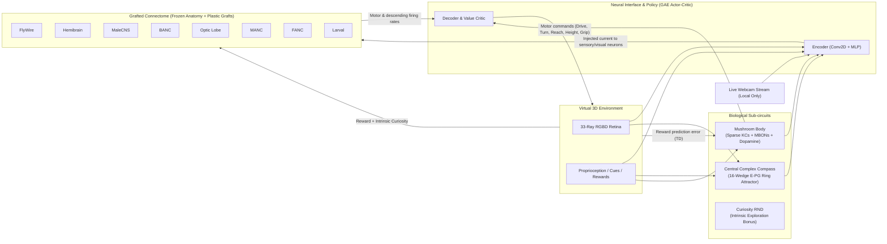

# GraftBrain

[](https://www.python.org/downloads/)
[](https://opensource.org/licenses/MIT)
[](https://fly-brain-hub.vercel.app/datasets)
[](https://arxiv.org/abs/1506.02438)

**GraftBrain** is a CPU-local lab for cross-wired neural graphs, adaptive graft routing, and embodied learning in a virtual environment. The default graph uses **synthetic statistical proxies** for eight *Drosophila* connectome families. Actual electron-microscopy (EM) data require an explicit import; dataset names in the default viewer do not establish that those data were loaded.

An artificial neural interface couples the graph to retina raycasting, optional webcam input, and motor actions. Simplified Central Complex compass and Mushroom Body modules accompany a Random Network Distillation curiosity signal. Atomic rolling checkpoints restore learned neural and plasticity state; world episodes restart on resume.

> [!IMPORTANT]
> **Evidence boundary**: Grafting is an artificial computational mechanism. Adaptive support selects among fixed candidate edge records; it does not grow new anatomical endpoints. This lab does not establish biological fidelity, general task advantage, or a speedup from sparse support. Historical performance and ablation numbers in `PAPER.md` are unverified claims without supporting run artifacts.

---

## Architecture Overview



---

## Key Features

1. **Multi-Connectome Ingestion & Provenance**
   - Provides synthetic proxy families named **FlyWire**, **Hemibrain**, **MaleCNS**, **BANC**, **Optic Lobe**, **MANC**, **FANC**, and **Larval Brain**.
   - Supports explicit FlyWire v783 Apache Feather imports, neuPrint REST queries, and CSV edge lists. Source availability and annotations depend on the selected import.
   - Uses a simplified neurotransmitter sign mapping: GABA and glutamate inhibitory, acetylcholine excitatory.

2. **Multi-Site Cross-Wiring ("Grafting")**
   - Rather than routing through an arbitrary single bottleneck, every pair of connectomes is cross-wired across three distinct structural mechanisms:
     - **Anatomical Interface Sites**: Preserves natural biological flow (brain descending neurons $\to$ nerve-cord motor circuits via the "neck connective", ascending neurons $\to$ central brain, optic lobe $\to$ central visual neuropils).
     - **Homolog Sites**: Reciprocally connects neurons sharing curated cell-type identifiers across releases.
     - **Reciprocal Central Bridges**: Spatially distributed multi-locus links across central neuropils.
   - Candidate endpoints remain fixed after graph construction. Live telemetry distinguishes candidate records from the active support; duplicate endpoints may occur as separate records.

3. **Dynamical Rate Model (`index_add`)**
   - 4 recurrent microsteps per simulation step:
     $$\mathbf{x} = \mathbf{W}_{\text{conn}} \mathbf{r} + \mathbf{W}_{\text{graft}} \mathbf{r} + \mathbf{b} + \mathbf{I}_{\text{drive}}$$
     $$\mathbf{r} \leftarrow (1 - \alpha)\mathbf{r} + \alpha \cdot \text{ReLU}(\tanh(\mathbf{x})) + \epsilon$$
   - Uses vectorized PyTorch `index_add` operations. Throughput depends on graph size, mode, and hardware; no current comparative speedup is established.
   - Connectome weights remain frozen; graft weights adapt via online gradient descent and three-factor Hebbian plasticity.

4. **Biological Sub-Circuits**
   - **Central Complex Compass (`CentralComplexCompass`)**: Models the 16-wedge Ellipsoid Body (EB) ring attractor. Integrates angular velocity $\omega$ and anchors to high-contrast visual cues, maintaining an internal heading angle to prevent disorientation.
   - **Mushroom Body Associative Memory (`MushroomBody`)**: Implements sparse Kenyon Cells (~6% top-$k$ Winner-Take-All) with Dopaminergic Neurons (DANs) modulating Mushroom Body Output Neurons (MBONs) based on reward/punishment TD error.
   - **Homeostatic Firing Rate Regulation**: Local neuronal bias currents slowly drift to maintain population firing rates near a stable setpoint ($\bar{r} \approx 0.12$).
   - **Intrinsic Curiosity (`CuriosityRND`)**: Random Network Distillation provides exploration bonuses in sparse-reward tasks.

5. **One-Pass GAE Actor-Critic & Adaptive Grafts**
   - One optimizer pass uses Generalized Advantage Estimation ($\gamma=0.98, \lambda=0.95$), retained action log likelihoods, policy/value gradients, and entropy regularization. It performs no old-policy reevaluation or repeated optimization epochs; it is not a full PPO trainer.
   - Optional observation-dependent site gains and budget-conserving prune/regrow change which artificial graft pathways carry activity. See the mode table below.

6. **Interactive 3D Web Dashboard & Visualizer**
   - Three.js 3D viewport with a separate browser render loop.
   - Live **Central Complex Polar Radar** displaying the heading direction bump.
   - Live activity raster maps across all 8 connectomes.
   - Live mode, active/candidate counts, site gains, structural swaps, and masked/gated signal flow.

7. **Rolling State Persistence**
   - Atomic checkpoints every 60 seconds and on process shutdown (`state/graftbrain.pt`).
   - Rolling automated backups (`.pt.1`, `.pt.2`) with automatic corruption recovery.
   - Full event logging into append-only JSON Lines journals (`*_journal.jsonl`).
   - Saves router parameters and optimizer, masks, coactivity, structural counters, settings, and local random generator state. It does not resume the exact world episode or outstanding autograd rollout.

---

## Installation

### Prerequisites
* Python 3.10, 3.11, or 3.12
* Windows, macOS, or Linux

```powershell
# Clone and enter the repository
git clone https://github.com/kai9987kai/Graft-brain.git
cd Graft-brain

# Install dependencies
python -m pip install -r requirements.txt
```

### Optional Dependencies
```powershell
# For real-time neuPrint queries (Janelia Hemibrain, MANC, MaleCNS)
pip install neuprint-python
```

---

## Quick Start

### 1. Launch Interactive 3D Viewer & Simulation
```powershell
python -m graftbrain run
```
Open **[http://127.0.0.1:8770](http://127.0.0.1:8770)** in your browser.

### 2. Run with Live Webcam Input
```powershell
python -m graftbrain run --webcam
```
*Note: Camera frames are processed strictly in-memory into 48x64 downsampled motion-energy maps and are never saved to disk. The server binds exclusively to `127.0.0.1`.*

### 3. Accelerated Headless Training
```powershell
python -m graftbrain train --steps 20000 --autosave 60
```

### 4. Inspect Graft Topology & Connections
```powershell
python -m graftbrain info
```

### 5. Start an Isolated Adaptive-Graft Run

```powershell
python -m graftbrain run --fresh --graft-mode adaptive --state state/adaptive-grafts.pt
```

The compatibility default is `legacy`. Use a separate state path for a new mode; changing a saved run's mode requires `--fresh`. Resume an adaptive checkpoint with its saved settings by omitting explicit graft settings:

```powershell
python -m graftbrain run --state state/adaptive-grafts.pt
```

| Mode | Active support | Observation-dependent site gains | Structural swaps |
|---|---|---|---|
| `legacy` | All candidate records | Fixed at 1 | No |
| `static` | Fixed sparse budget | Fixed at 1 | No |
| `routing` | Fixed sparse budget | Learned | No |
| `structural` | Sparse budget conserved per directional site bucket | Fixed at 1 | Yes |
| `adaptive` | Sparse budget conserved per directional site bucket | Learned | Yes |

The four sparse modes use the same seeded initial support. A zero-initialized linear router reads the public observation and computes a gain `2 * sigmoid(logit)` per site, held fixed across that action's recurrent microsteps. It learns through the existing actor-critic gradients, with a small mean-gain regularizer.

Structural modes track detached pre/post coactivity for active and dormant candidates. After complete learning updates, they periodically replace low `abs(weight) * coactivity` active records with high-coactivity dormant records. Each `(site, source connectome, target connectome)` bucket retains its active budget. Regrown records recover their original signed initialization; affected eligibility traces, pending Hebbian updates, and Adam moments are cleared. Base connectome wiring remains frozen.

Defaults are density `0.6`, interval `10` learning updates, turnover `0.1`, and warmup `2` updates. Candidate-sized tensors are still computed: this is a support constraint, with no demonstrated reduction in wall-clock time or memory. The approach draws on [RigL](https://proceedings.mlr.press/v119/evci20a.html) and [Sparse Evolutionary Training](https://www.nature.com/articles/s41467-018-04316-3); its growth score is candidate coactivity, whereas RigL uses dormant-edge gradients.

### Research Controls: Gradient Recruitment and Maturation

An optional gradient rule scores dormant candidates from the learning objective, before the active-mask chain rule. Dormant records still contribute no signal and receive no raw-weight gradient. Signed derivatives accumulate across the rollout; an absolute-gradient EMA updates once after backward. These are loss sensitivities, not direct causal reward attribution or guaranteed loss improvements.

```powershell
python -m graftbrain run --fresh --graft-mode adaptive --graft-growth gradient --graft-growth-init zero --graft-min-age 20 --state state/gradient-grafts.pt --port 8771
```

`--graft-growth` selects `coactivity`, `gradient`, or a private-seeded `random` control. `--graft-growth-init zero` starts regrown weights at zero; dropping old records can still change behavior. `--graft-min-age` protects each newly activated record for that many completed learning updates. If too few mature records exist, actual turnover shrinks while directional budgets stay fixed. Defaults remain `coactivity`, `original`, and `0`; old checkpoints migrate to those defaults. Resume using saved settings; changing a run's policy requires a fresh state.

The viewer reports protected/mature records, finite-gradient evidence coverage, cohort gradient scales, and separate intervention counters. Coverage includes measured zero gradients, while gradient recruitment requires positive finite scores. Older running backends display unavailable diagnostics instead of inventing values. Saved-next-decision checks apply at completed learner updates under identical subsequent inputs/RNG, not arbitrary mid-rollout world continuation.

Gradient recruitment adapts [RigL](https://proceedings.mlr.press/v119/evci20a.html). Minimum age and cohort measurements are engineering hypotheses informed by a [2026 preprint on growth integration](https://arxiv.org/abs/2605.15435v3), whose unit/channel experiments do not validate edge protection in this recurrent RL lab. [Module-specific sparse-RL findings](https://arxiv.org/abs/2510.12096v1) further motivate keeping adaptation confined to grafts.

---

## Environments & Cognitive Tasks

The agent is embodied as a mobile base equipped with a 2-degree-of-freedom arm (reach, height) and an open/close gripper. The world provides 9 distinct tasks across navigation, manipulation, and cognition:

| Task | Domain | Objective | Reward Scheme |
|---|---|---|---|
| `forage` | Navigation | Navigate to open-field food targets | Potential-based distance shaping + goal reward (+5.0) |
| `maze` | Navigation | Navigate a randomly generated DFS labyrinth | BFS geodesic distance gradient + exit reward (+8.0) |
| `push` | Manipulation | Push a heavy colored block onto a designated target pad | Box-to-pad distance delta + placement reward (+6.0) |
| `grasp_place` | Fine Motor | Approach a cube, grasp with gripper, lift, and drop into bin | Grasp bonus (+1.0) + distance to bin + deposit (+6.0) |
| `peg_insert` | Fine Motor | Align arm with peg, lift, and insert into tight circular hole | Precision alignment delta + insertion reward (+6.0) |
| `delayed_match` | Cognition | Observe sample cue color $\to$ 20-step delay $\to$ choose match | Correct match (+5.0), incorrect choice (-2.0) |
| `go_nogo` | Cognition | Green cue: reach target; Red cue: withhold action for 80 steps | Correct go/no-go (+3.0), false alarm/miss (-3.0) |
| `button_sequence` | Cognition | Observe 3-color sequence cue, then press matching buttons in order | Sequential button press (+2.0 each) + completion (+5.0) |
| `webcam_chase` | Sensorimotor | Track and chase a moving visual orb driven by live webcam motion | Azimuth alignment bonus + proximity reward (+0.02/step) |

---

## Real Connectome Ingestion

Explicit imports can replace the synthetic proxies. Imported releases are subsampled to the configured neuron budget:

### FlyWire FAFB v783 (Zenodo)
```powershell
# 1. Download official FlyWire proofread connections (~1 GB, CC-BY-NC-4.0)
python -m graftbrain fetch-flywire

# 2. Run GraftBrain using FlyWire as the brain backbone
python -m graftbrain run --fresh -c flywire:data/proofread_connections_783.feather -c proxy:manc -c proxy:optic-lobe
```

### neuPrint (Janelia Hemibrain / MANC / MaleCNS)
```powershell
# Set your neuPrint API authorization token
$env:NEUPRINT_APPLICATION_CREDENTIALS = "<YOUR_TOKEN>"

# Run with direct neuPrint queries
python -m graftbrain run --fresh \
  -c neuprint:hemibrain:v1.2.1 \
  -c neuprint:manc:v1.2.1 \
  -c neuprint:optic-lobe:v1.1 \
  -c proxy:banc
```

### Generic CSV Ingestion
Any tabular network can be loaded with custom column mappings:
```powershell
python -m graftbrain run -c "csv:path/to/edges.csv@name=CustomCNS,kind=cns,annotations=nodes.csv"
```

---

## CLI Reference

```
usage: graftbrain [-h] {run,train,info,fetch-flywire,benchmark-plasticity} ...

positional arguments:
  run               Launch closed-loop simulation with live 3D web viewer
  train             Run headless accelerated training loop
  info              Inspect and summarize grafted connectome graph topology
  fetch-flywire     Download FlyWire v783 connectivity dataset (~1 GB)
  benchmark-plasticity  Paired five-mode training and frozen-evaluation pilot

options:
  -c, --connectome  Connectome specification (proxy:*, flywire:*, neuprint:*, csv:*)
  --max-neurons     Neuron budget per connectome (default: 1500)
  --state           Checkpoint save path (default: state/graftbrain.pt)
  --fresh           Ignore existing checkpoints and build new graph
  --task            Fixed task name or 'auto' curriculum
  --webcam          Enable live webcam processing
  --autosave        Autosave interval in seconds (default: 60)
  --microsteps      Neural microsteps per world step (default: 4)
  --port            Web server port for 'run' command (default: 8770)
  --steps           Step limit for 'train' command (default: 10000)
  --seed            Random seed (default: 0)
  --graft-mode      legacy, static, routing, structural, adaptive (default: legacy for new runs)
  --graft-density   Active fraction per directional site bucket, (0, 1] (default: 0.6)
  --graft-interval  Complete learner updates between rewiring attempts (default: 10)
  --graft-warmup    Updates before structural adaptation (default: 2)
  --graft-turnover  Fraction of each active bucket replaced, [0, 1] (default: 0.1)
  --graft-router-lr Router Adam learning rate (default: 0.0001)
```

---

## Web Dashboard Guide

When running `python -m graftbrain run`, the dashboard at `http://127.0.0.1:8770` provides:

* **3D Viewport**: Orbit with Left Click + Drag, Pan with Right Click + Drag, Zoom with Scroll.
* **HUD (Top Left)**: Current task, elapsed step ($t$), episode index, cumulative return, and active visual cue color.
* **Control Bar**:
  * **Task Selector**: Force immediate curriculum switch to any of the 9 tasks.
  * **Pause / Resume**: Freeze physics and neural dynamics.
  * **Save Now**: Trigger an immediate atomic checkpoint.
  * **Reset Activity**: Zero all membrane voltages and eligibility traces while preserving learned weights.
  * **Speed Slider**: Throttle execution from 1 Hz up to 120 Hz or unthrottled maximum.
* **Telemetry Panels**:
  * **Central Complex Radar**: Polar rendering of the 16 E-PG heading wedges.
  * **Mushroom Body**: Live Kenyon Cell activation percentage and MBON approach/avoidance valence.
  * **Return Chart**: Rolling 200-episode learning curve.
  * **Success Rate**: Rolling 50-episode completion rates per task.
  * **Connectome Rasters**: Live activity heatmaps across each sub-graph.
  * **Neural Plasticity**: Saved mode, active/candidate budget, dormant count, update/rewire counters, and current site-gain spread.
  * **Graft Sites Table**: Active/candidate edge-record counts, gain, swaps, $|w|$, and effective flow at the busiest sites. Flow includes the active mask and current gain.

`/api/topology` describes candidate topology and exposes active support separately; a candidate is not necessarily an active synapse.

---

## Verification & Testing

Run the discoverable regression suite for mechanism, learner, persistence, and CLI checks:

```powershell
python -m pip install pytest
python -m pytest -q
```

The [adaptive-graft verification report](docs/verification-adaptive-grafts.md) records the current checks, CPU pilot artifacts, protected-state hashes, and evidence limits.

The [graft-credit verification report](docs/verification-graft-credit.md) records gradient/maturation checks, the balanced RL pilot's zero observed improvement, and the bounded supervised recovery results.

The [validation continuation](docs/verification-graft-continuation.md) adds behavior/trajectory diagnostics and a locally frozen17-seed supervised confirmation. It also records the longer RL study's unfavorable forage outcomes and flat go/no-go outcomes; synthetic recovery is not task-performance evidence.

`tests/test_tasks.py` also contains scripted oracle probes. Oracle behavior is a separate question from policy learning; positive shaped return is not a terminal success, especially for the tracking task. Historical printed `10/10` rows alone do not establish learned capability.

The `benchmark-plasticity` command compares all five modes with paired graph/training seeds, matched environment-step budgets, and held-out evaluation seeds. For a bounded default-size pilot, choose a new output directory:

```powershell
python -m graftbrain benchmark-plasticity --out runs/plasticity-pilot --train-steps 512 --tasks forage go_nogo --seeds 0 --eval-seeds 1000 1001 --max-neurons 400 --microsteps 2
```

This uses synthetic FlyWire and MANC proxies (up to 800 nodes total), with 512 training environment steps per mode/task and training seed. It writes a manifest, per-episode terminal outcomes, returns, support turnover, gain spread, and wall-clock summaries. Training episodes cut off by the step budget are recorded as nonterminal `budget_exhausted`; a positive return is not a success label. Frozen evaluation disables learning, Hebbian/RND/router/structural changes, homeostatic adaptation, and trace accumulation, resets episodic neural/compass state, and uses policy mean actions. Consult `python -m graftbrain benchmark-plasticity --help` for other settings. Small synthetic CPU pilots check the mechanism; they do not establish a general task advantage.

For the new growth rules, use balanced pre/post evaluation with seven matched controls:

```powershell
python -m graftbrain benchmark-graft-credit --out runs/graft-credit-pilot --train-steps 384 --tasks forage go_nogo --seeds 0 --eval-seeds 1000 --max-neurons 400 --microsteps 1
python -m graftbrain probe-graft-credit --out runs/graft-recovery-probe --seeds 0 1 2 --train-steps 80 --recovery-steps 80
```

Each go/no-go evaluation anchor creates a declared go and no-go scenario before agents run. The benchmark compares coactivity, gradient and random recruitment at minimum ages 0/20, plus routing without rewiring; it holds initialization and budgets fixed. It records zero-action references, paired pre/post deltas, separate completed/truncated training returns, source hashes, library versions and structural events. Evaluation episodes are repeated measurements, not independent training seeds.

The supervised probe uses a hand-declared current target switch and support replacement. It compares sham, replacement with rewiring, and replacement with rewiring disabled, preserving the trained source. Replacement can immediately help a switched target; it is not necessarily damage. Its current-error results are not RL-task or biological evidence. Both commands refuse existing output directories and retain every requested seed's outcome.

Episode reports include initial/closest/final target distance, actual path length, clipped command statistics and paired changes. Command norm is dimensionless, and closer is not universally better on no-go. Probe reports include full-trajectory normalized MSE area, the last10-update mean, phase-specific pre/post edit error, and evaluation-only old-target error. The old/new labels conflict on identical inputs, so their tradeoff is not a general forgetting test.

---

## Scientific Citations & Attributions

When utilizing experimental datasets in academic research, please cite the respective sources:

* **FlyWire Whole-Brain Connectome (v783)**:
  * Dorkenwald, S. et al. *Neuronal wiring diagram of an adult brain.* Nature 634, 124–138 (2024). DOI: [10.1038/s41586-024-07558-y](https://doi.org/10.1038/s41586-024-07558-y).
  * Schlegel, P. et al. *Whole-brain annotation and multi-connectome mapping of Drosophila.* Nature 634, 139–152 (2024).
  * Shiu, P. K. et al. *A leaky integrate-and-fire computational model of the adult Drosophila brain.* Nature 634, 153–165 (2024).
* **Hemibrain Connectome**:
  * Scheffer, L. K. et al. *A connectome and analysis of the adult Drosophila central brain.* eLife 9:e57443 (2020).
* **Male Adult Nerve Cord (MANC)**:
  * Takemura, S. et al. *A connectome of the male Drosophila ventral nerve cord.* bioRxiv (2023).
* **Central Complex Compass & Navigation**:
  * Seelig, J. D. & Jayaraman, V. *Neural dynamics for landmark orientation and angular path integration.* Nature 521, 186–191 (2015).
  * Hulse, B. K. et al. *A connectome of the Drosophila central complex reveals network motifs suitable for flexible navigation and goal-directed behavior.* eLife 10:e66039 (2021).

---

## License

This software codebase is released under the [MIT License](LICENSE). Connectome datasets (FlyWire, Hemibrain, etc.) are governed by their respective licenses (CC-BY-4.0 / CC-BY-NC-4.0); please observe data license terms when using raw connectome weights.
